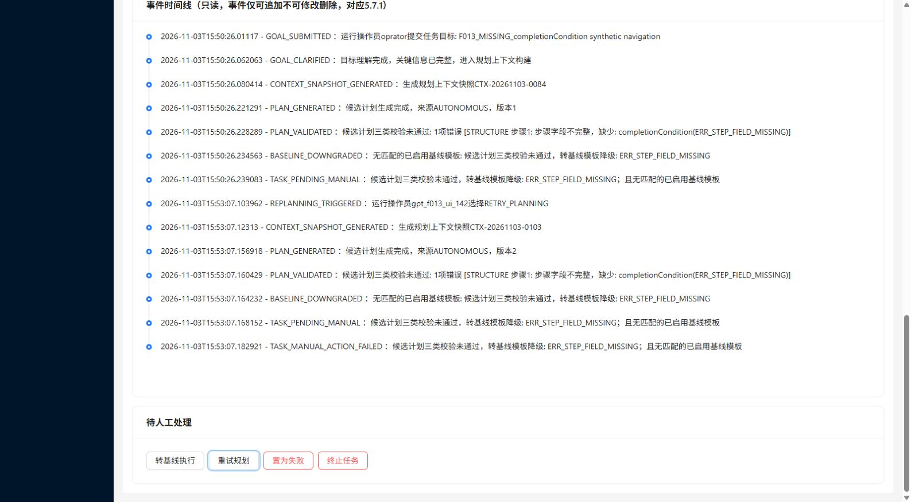

# SRS_F013 V1.142 独立复测与目标重试缺陷交接

- 日期：2026-11-03（Asia/Shanghai）；执行/用例基线 V2.3。
- 产品标签 `V1.142` → `28bfb28eef45af0c058bf675e62d2d45b6424102`，交接 `22e319500e12664ffb10475b9a37a881dc62fc05`，已fetch并快进合入独立 `tip-gpt-f013` / `ai/gpt-test`。
- **裁决：READY_FOR_CLAUDE。DEF-S3-089、DEF-S3-090复测通过；新缺陷DEF-S3-091导致TC-042.S1 / R06为F，F013整项未通过。** 按V2.3及时交修，不把剩余未执行范围记为P，不推进F014或main。

## 已通过的修复与本轮业务观察

| 范围 | V1.142 实测与证据 |
| --- | --- |
| DEF-S3-090 | 独立源码离线打包成功，JAR真实启动，健康UP；Spring上下文与F013定向测试合计16项，0失败/错误。[环境与原始输出](evidence/SRS_F013-V1.142-summary-and-environment-20261103.json) |
| DEF-S3-089；TC-040.S2、TC-041.S3、R07 | 任务118/119两种结构失败候选，分别FORCE_RELEASE/REQUEST_SUPERVISION，共4次，全部HTTP400/4110；每次新增一条已落库拦截事件和INTERCEPTED审计，计划不变、待人工、零分配/指令。另在能力失败任务135、约束失败任务137各测两动作，再4次全部通过。原V1.140 F与V1.141启动失败记录保留。[原缺陷四次复测](evidence/SRS_F013-V1.142-hard-gate-persistence-20261103.json)、[能力/约束分支四次复测](evidence/SRS_F013-V1.142-summary-and-environment-20261103.json) |
| TC-040.S1；R01、R05 | 任务120–139共20个无效等价类：六个必需字段分别缺失；六动作超限无截断；自依赖、前向依赖、不存在依赖；循环、递归参数内动态代码、无限协商；虚构/未启用能力、无在线候选、超任务定义、运动安全字段、非法参数、三类同时错误。全部待人工、未冻结、零分配/指令。六步在生成边界直接拒绝，未生成被截断版本；任务139三类均FAIL且错误汇总。[异常矩阵](evidence/SRS_F013-V1.142-batch-MISSING_stepGoal-to-MULTI-20261103.json) |
| 有效边界与冻结子检查 | 任务140单动作、141五动作、142合法前序依赖均三类PASS并冻结，随后进入监督，资源临界规则HIGH后无基线转人工。未关闭规则或把该高风险结果当成校验失败。API对任务140传入新taskGoal重试，目标与事件更新、产生冻结V2，V1逐字段保持不变。[有效样本](evidence/SRS_F013-V1.142-batch-GOOD-to-VALID_DEP-20261103.json)、[API目标修改对照](evidence/SRS_F013-V1.142-actions-and-target-retry-20261103.json) |
| R09 | 失败版本错误的类型、步骤、描述、原因码和数量写入PLAN_VALIDATED摘要，能力/约束/结构失败分支均可追溯；浏览器任务124显示三类结果、错误清单和含ERR_STEP_FIELD_MISSING的时间线。[页面文字](evidence/SRS_F013-V1.142-retry-task124-ui-20261103.txt)、[完整截图](evidence/SRS_F013-V1.142-retry-task124-ui-20261103.png)、[矩阵及API事件](evidence/SRS_F013-V1.142-batch-MISSING_stepGoal-to-MULTI-20261103.json) |

这些观察未覆盖合规超规行李四渠道、设备类型越界、资源冲突、基线二次校验、手动失败及局部重规划不可变性的完整业务分支，不能推断整项通过。

## DEF-S3-091：待人工页面无法修改目标重试

级别中，关联 **TC-042.S1 / SRS_F013.R06**。

1. 使用虚构操作员登录GPT隔离前端，打开结构失败、待人工的任务124：目标 `F013_MISSING_completionCondition synthetic navigation`，自主V1未冻结。
2. 页面只有“转基线执行”“重试规划”“置为失败”“终止任务”按钮；任务目标为只读文本，没有目标编辑表单，也没有返回目标提交页的入口。
3. 用键盘明确激活“重试规划”。页面没有打开目标修改表单，也没有返回目标提交页；直接以原目标重新生成V2，仍因缺少completionCondition失败、回到待人工。
4. API和审计确认真实动作是RETRY_PLANNING，目标逐字未变，没有TASK_GOAL_UPDATED事件；实际模型请求也仍携带旧目标。
5. 对照：独立API给任务140提交 `RETRY_PLANNING` 和新taskGoal，后端成功更新目标、重新理解/规划并生成新版本。因此缺口在操作员界面：`TaskDetailView.vue`只调用`manualAction(taskId, action)`，未收集和传递API已支持的taskGoal。

预期：操作员能在该失败处置流程修改目标并提交重试，保留原版本，通过三类校验后再处理；可采用编辑弹窗或返回预填的目标提交页，不能要求操作员自行调用API完成核心处置功能。请修复后验证实际新目标、TASK_GOAL_UPDATED/重新理解事件、模型输入、版本保留和校验闸门。

证据：[任务124真实动作、模型输入及API正向对照](evidence/SRS_F013-V1.142-actions-and-target-retry-20261103.json)，[处置区截图](evidence/SRS_F013-V1.142-retry-task124-actions-20261103.png)。

## 本轮 P/F/NT 与证据口径

- 本版完整步骤P：TC-040.S1/S2、TC-041.S3；完整规则P：R01、R05、R07、R09。
- 本版F：TC-042.S1、R06（DEF-S3-091）。
- 本版整步NT：TC-039.S1/S2、TC-041.S1/S2、TC-042.S2；完整规则NT：R02–R04、R08。上述部分子检查通过不等于整步/整规则通过。
- 累计台账R02保留旧V1.5历史P及原SHA来源，不改写成本版实测P。累计规则为P:5/F:1/NT:3，其中R02是历史覆盖；本版完整规则为P:4/F:1/NT:4。旧F和原始证据均保留。
- 浏览器首次指针探针任务123原本意图激活重试，实际审计却为MARK_FAILED。作为浏览器动作定位不匹配保留在[首次探针记录](evidence/SRS_F013-V1.142-retry-ui-20261103.json)中，**不据此报告产品错误或手动失败通过**。改用任务124键盘激活，并由真实RETRY_PLANNING审计确认后，才用于DEF-S3-091裁决。
- 内置浏览器最初连接/开页超时，随后发现已创建的页并恢复，没有计为产品缺陷。定向单测首次命令工作目录不正确，纠正到backend后16项通过；首次命令不计产品结论。

## 环境和后续交接

GPT专属schema `tip_gpt_f006_v118_20261030`、Redis10、后端18129、受控模型18117、机器人18132、前端15179。受控模型使用虚构目标；[模型请求](evidence/SRS_F013-V1.142-model-requests-20261103.jsonl)不含账号密码或令牌。临时UI账号已停用，临时浏览器已关闭；四个GPT自有进程停止、四端口释放，资源风险规则仍启用，任务120–142零活跃分配/设备指令。未改产品代码、能力/模板/规则配置或Claude资源。未上传原始Office资料。

Claude先fetch并合入最新origin/ai/gpt-test，修复DEF-S3-091后交下一唯一V1.N。下一轮按影响复核复用本版已通过且未受影响观察，不重复制造证据；补测合规超规行李计划三类PASS/冻结/监督、离线与设备类型边界、资源冲突/行李时序、基线再次三类校验、手动失败和冻结版本/局部新版本的剩余断言。整项通过后才合main。
