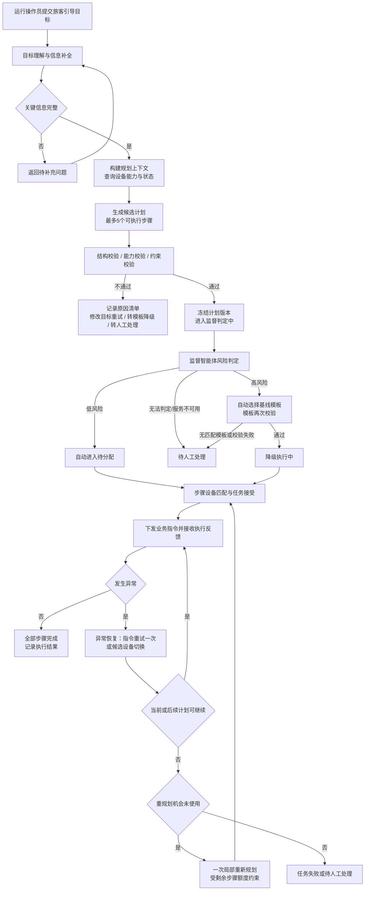
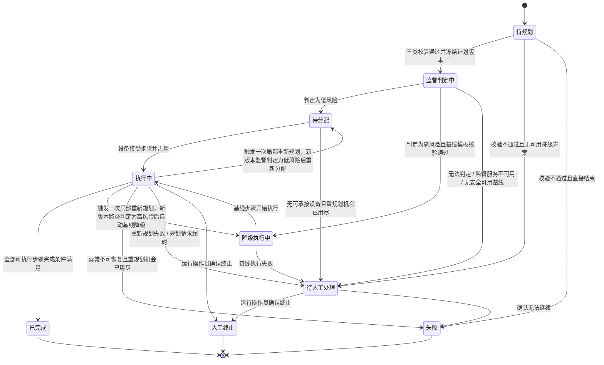
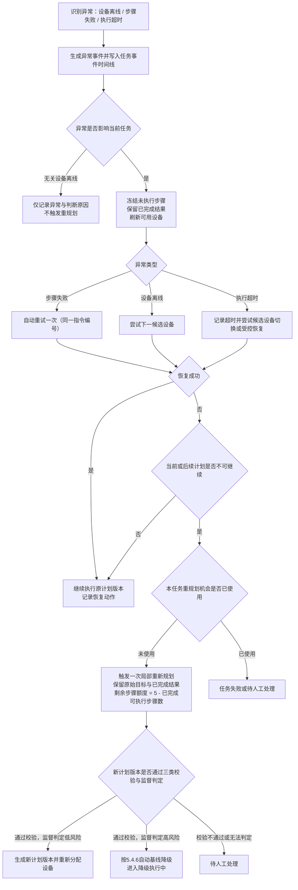
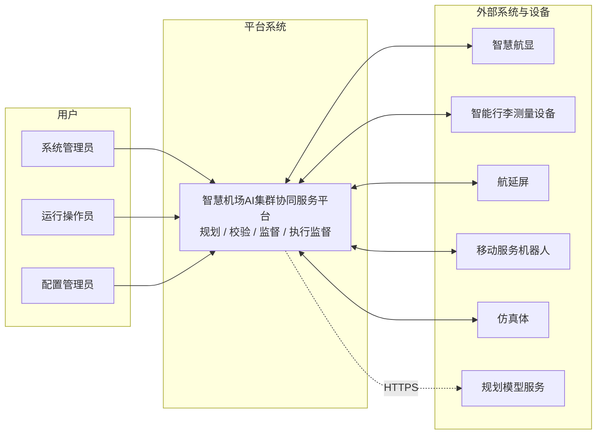

# 华东凯亚

# 面向智慧机场的人工智能集群协同服务关键技术研究

# 需求规格说明书

| | | |
|---|---|---|
| | 文件编号： | CARES_CMMI_3_4_008_003 |
| | 文档版本： | V1.4 |
| | 文档状态： | ■草稿　□修订中　□已发布 |
| | 密级： | □机密　□密　■内部公开 |
| | 总页数： | — |
| | 制订部门： | 华东凯亚 |

## 修订记录

| 版本号 | 修订日期 | 修订人 | 评审人 | 批准人 | 修改内容/受影响部分 |
|---|---|---|---|---|---|
| V1.0 | 2026-08-11 | [编制人] | | | 建立，形成SRS需求规格说明书初稿 |
| V1.1 | 2026-08-12 | [编制人] | | | 按裁剪范围调整功能需求，补充研究评测与过程追溯 |
| V1.2 | 2026-09-01 | [编制人] | | | 依据《面向智慧机场的人工智能集群协同服务关键技术研究-用户需求说明书-V1.2（监督降级版）》，按公司《需求规格说明书》模板重新编制：引入监督智能体风险闸门与高风险自动基线降级，取消正常流程人工确认环节；明确计划版本与最终执行路径双层五步限制、先恢复后判定的局部重新规划口径、运动安全责任边界；删除本期未承诺的研究评测与导出功能 |
| V1.3 | 2026-09-03 | [编制人] | | | 完善技术架构规范、接口设计规范、性能指标详表、安全与权限设计、数据管理规范、运维监控方案、测试验收标准、UI/UX规范等内容；新增技术规格附录A-E共5个文档；新增5.2.4A设备类型能力边界管理功能需求（SRS_F006A），并配套附录F《五类设备能力边界清单》 |
| V1.4 | 2026-09-04 | [编制人] | | | 将V1.2全部正文内容与V1.3全部新增内容（1.9技术架构概览、5.2.4A设备类型能力边界管理、附录F五类设备能力边界清单等）完整合并为单一自包含文档；5.2.4A功能需求全文内嵌于5.2节，附录F全文内嵌于第八章；文档内不再包含指向外部独立文件的链接 |

## 目录

- [一、软件概述](#一软件概述)
  - [1.1 项目目标](#11-项目目标)
  - [1.2 软件范围](#12-软件范围)
  - [1.3 用户分类和特征](#13-用户分类和特征)
  - [1.4 运行环境](#14-运行环境)
  - [1.5 设计和实现上的限制](#15-设计和实现上的限制)
  - [1.6 外部依赖](#16-外部依赖)
  - [1.7 词汇表](#17-词汇表)
  - [1.8 参考资料](#18-参考资料)
  - [1.9 技术架构概览](#19-技术架构概览)
- [二、需求列表](#二需求列表)
  - [2.1 优先级定义](#21-优先级定义)
  - [2.2 需求列表](#22-需求列表)
- [三、流程图](#三流程图)
  - [3.1 业务主流程](#31-业务主流程)
  - [3.2 任务状态机](#32-任务状态机)
  - [3.3 异常恢复与局部重新规划流程](#33-异常恢复与局部重新规划流程)
- [四、需求追踪](#四需求追踪)
- [五、功能需求](#五功能需求)
  - [5.1 基础系统管理](#51-基础系统管理)
  - [5.2 设备接入与设备代理管理](#52-设备接入与设备代理管理)
  - [5.3 基线服务模板管理](#53-基线服务模板管理)
  - [5.4 开放式自主任务规划](#54-开放式自主任务规划)
  - [5.5 多设备协同执行与监督](#55-多设备协同执行与监督)
  - [5.6 旅客引导任务族与二维态势](#56-旅客引导任务族与二维态势)
  - [5.7 过程追溯与操作记录](#57-过程追溯与操作记录)
- [六、非功能需求](#六非功能需求)
- [七、接口需求](#七接口需求)
  - [7.1 硬件接口](#71-硬件接口)
  - [7.2 软件接口](#72-软件接口)
- [八、附录](#八附录)
  - [8.1 待确定的问题列表](#81-待确定的问题列表)
  - [8.2 验收口径](#82-验收口径)
  - [8.3 技术规格文档清单](#83-技术规格文档清单)
  - [8.4 五类设备能力边界清单](#84-五类设备能力边界清单)

## 一、软件概述

### 1.1 项目目标

航站楼内的智慧航显、服务机器人等设备通常由不同厂商建设，设备协议、能力描述和任务接口不一致。传统平台主要依赖预置流程，面对开放式任务目标时难以根据实时设备状态自主分解任务、组合能力并调整执行计划。

本项目建设一个研究验证原型，将每台设备以设备代理形式接入平台，通过开放式任务目标理解、自主任务规划、多设备协同执行、执行监督与有限动态调整，验证异构设备集群能否理解、规划并完成开放式旅客服务任务。具体目标：

1. 实现设备统一接入：以统一方式接入5类设备或仿真体，持续维护设备状态与能力画像，形成可查询、可调度的设备资源池。
2. 实现开放式任务规划：用户以自然语言提交旅客引导目标，系统自动生成经校验的可执行计划，替代预置流程编排。
3. 实现多设备协同执行：根据计划自动选择在线、空闲且具备所需能力的设备，有序完成各步骤。
4. 实现受控的执行监督与动态调整：由监督智能体对候选计划做风险判定，低风险自动执行、高风险自动降级至基线模板，对设备离线、步骤失败和执行超时进行受控恢复与一次局部重新规划。
5. 保障可管理、可追溯：提供运行总览、二维态势、任务监控、执行过程追溯和操作记录。

项目以旅客引导服务为业务验证场景，覆盖超规行李处置、特殊旅客服务和航班变更应对三类核心任务族，并支持在已有能力类型范围内扩展其他旅客服务任务。项目周期3个月（12周），团队为2名产品经理、6名开发人员，测试由其他团队承担。

### 1.2 软件范围

范围内：

- PC端Web管理后台（面向系统管理员、运行操作员、配置管理员）与后端服务。
- 设备接入与设备代理管理、设备类型能力边界管理、设备能力画像管理、统一设备代理消息封装。
- 开放式任务目标理解、规划上下文构建、候选计划生成、结构/能力/约束三类校验。
- 监督智能体风险判定、高风险自动基线降级、基线服务模板管理与试运行。
- 多设备协同执行、执行监督、异常恢复、一次局部重新规划、人工终止。
- 三类核心旅客服务场景闭环、二维态势展示、任务过程追溯与操作记录。

范围外（明确非目标）：

- 不提供移动端App、旅客自助端和大屏专用端。
- 不承担设备运动安全控制：速度、加速度、姿态、路径点、避障、急停、限速和失联停靠等由设备本体或仿真环境负责。
- 不提供可视化拖拽流程编排、并行/条件分支/循环/补偿事务等复杂编排能力。
- 不提供在线地图编辑、地图版本管理、坐标标定和历史轨迹回放。
- 不保存全量高频遥测数据，不做长周期数据分析与BI报表。
- 不保存旅客真实身份信息，不与机场生产系统（真实FIDS、安检、值机）做生产级对接。
- 规划模型服务的详细OpenAPI 3.1契约、JSON Schema和错误码另行编制，不在本说明书内定义。

### 1.3 用户分类和特征

| 用户分类 | 特征 | 主要职责 | 权限范围 |
|---|---|---|---|
| 系统管理员 | 平台运维人员，熟悉账号与基础配置管理，使用频率低 | 维护账号、查看操作记录、初始化基础配置 | 全部功能 |
| 运行操作员 | 机场运行现场值班人员，业务熟练但不具备编程能力，是系统主要使用者，使用频率高 | 提交开放式任务目标；处置监督智能体无法判定或基线执行失败的任务；监控异常与终止任务 | 自主规划、任务监控、二维态势 |
| 配置管理员 | 实施与配置人员，理解设备协议与能力定义，在准备阶段集中使用 | 维护设备类型能力边界、设备、设备代理、能力画像、基线模板、确定性高风险规则和旅客服务任务定义 | 设备代理、能力、基线模板、任务定义、风险规则 |
| 旅客（间接用户） | 航站楼内旅客，不登录系统，通过设备被动接受服务 | 接受航显、航延屏、机器人等设备提供的引导与服务 | 不直接操作系统 |
| 设备/仿真体（外部参与者） | 5类接入对象，通过平台统一设备接口上报状态、接受并执行业务指令 | 上报状态、接受/拒绝任务、反馈执行结果 | 仅设备接口 |

### 1.4 运行环境

| 项目 | 说明 |
|---|---|
| 部署环境 | 一套服务器或开发验证环境即可，具体配置按实施环境确定 |
| 服务端 | 后端服务与数据库部署于同一套环境；不要求高可用集群、异地容灾 |
| 客户端 | PC端浏览器，支持Chrome、Edge当前主版本；推荐分辨率1920×1080，最低1366×768 |
| 网络 | 平台与设备/仿真体在同一可达网络内；与规划模型服务之间通过HTTPS访问 |
| 共存应用 | 规划模型服务（外部服务或本地模型）；设备仿真程序 |
| 运行规模 | 并发后台用户不超过10人，接入设备或仿真体不超过20个，并发任务不超过10个 |

### 1.5 设计和实现上的限制

1. 交付形态限制：仅提供PC端Web管理后台和后端服务，不做移动端与旅客自助端。
2. 接入规模限制：首期接入设备和仿真体合计不超过10个，覆盖智慧航显、智能行李测量设备、航延屏、移动服务机器人和仿真体5类；系统性能设计上限为20个接入对象（详见8.1 TBD-01）。
3. 设备代理一一对应限制：每台设备在平台侧对应一个设备代理，设备能力、状态和任务交互必须通过平台统一封装，不允许业务功能直连设备私有协议。
4. 计划复杂度限制（双层五步）：每个候选计划版本最多包含5个可执行步骤，且任务最终实际执行路径也不得超过5个可执行步骤；条件节点不计数，条件分支中的业务动作计数；不支持循环、动态代码生成执行和无限轮次协商。
5. 重新规划次数限制：每个任务最多触发一次局部重新规划，且必须先执行指令重试或候选设备切换，只有异常导致当前或后续计划不可继续时才消耗重规划机会。
6. 安全责任边界限制：平台只允许下发前往区域、会合、陪同、空间引导和现场通知等业务意图，不得下发运动安全控制指令；人工终止为业务终止，不等同于设备安全急停。
7. 风险闸门限制：结构、能力、约束三类校验为硬性闸门，监督智能体和人工均无权绕过或强行放行；任何模型异常或校验失败均不得触发设备指令。
8. 编排能力限制：基线模板只支持顺序步骤，不支持并行、条件分支、循环、补偿事务和可视化拖拽编排。
9. 数据限制：不保存旅客真实身份信息，演示使用虚构或脱敏数据；仅保存设备最新状态及必要事件，不保存全量高频遥测。
10. 通信限制：管理后台与后端服务、平台与规划模型服务之间采用HTTPS通信；敏感凭据不在页面回显原值，密码使用不可逆摘要存储。
11. 能力边界限制（V1.4沿用V1.3）：设备实例配置的能力类型必须在其所属设备类型的能力边界之内，超出边界的能力配置须被系统拒绝；仿真体必须选定所模拟的设备类型并继承其能力边界，不得配置为不限定类型的"全能仿真体"。

### 1.6 外部依赖

| 依赖项 | 依赖内容 | 风险与应对 |
|---|---|---|
| 演示设备或仿真体 | 能够稳定提供状态上报和任务执行反馈 | 真实设备不到位时以仿真体替代；仿真体为验收基线 |
| 规划模型服务 | 至少一种可稳定获得的规划模型服务或本地模型 | 模拟模型仅用于接口自测，不作为验收基线；模型不可用时按基线模板降级或转人工 |
| 航站楼局部区域平面图 | 预置二维底图及设备坐标 | 由实施方在部署前提供静态底图，不提供在线编辑 |
| 演示数据 | 虚构或脱敏的航班、行李、旅客服务数据 | 由项目组统一准备，不使用真实旅客数据 |
| 规划模型接口契约文档 | 详细OpenAPI 3.1契约、JSON Schema和错误码 | 另行编制，与本说明书并行推进，接口变更走变更评审 |
| 测试团队 | 测试设计与执行由其他团队承担 | 需求冻结后同步交付测试团队，验收口径见8.2 |

### 1.7 词汇表

| 名词 | 解释 |
|---|---|
| 设备 | 接入平台、可上报状态并执行能力的真实设备或仿真体 |
| 仿真体 | 按选定设备能力画像模拟真实设备及异常事件的模拟对象 |
| 设备代理 | 平台侧与单台设备一一对应的软件对象，统一维护设备身份、能力、状态和任务交互，不等同于设备本体控制器 |
| 设备类型 | 平台预置的五类设备类型：智慧航显、智能行李测量设备、航延屏、移动服务机器人、仿真体 |
| 能力 | 设备可被平台统一调用的最小业务功能单元，如信息展示、行李测量、空间引导 |
| 能力类型 | 平台预置的八类标准能力类型：综合信息展示、行李尺寸重量测量、超规事件上报、航班变更信息发布、空间引导、陪同服务、现场通知、仿真状态生成 |
| 设备类型能力边界 | 定义某设备类型支持哪些能力类型、不支持哪些能力类型的约束规则 |
| 能力模板 | 为设备类型预置的标准能力定义，包含能力编码、名称、输入输出参数、适用条件等 |
| 能力画像 | 描述某设备实例可提供能力的结构化定义，含能力编码、类型、输入输出参数、适用条件和可用状态 |
| 开放式自主任务规划 | 根据自然语言任务目标、设备能力和状态自动生成并执行候选任务计划的核心研究能力 |
| 规划上下文 | 生成候选计划前汇总的设备能力、在线状态、位置、负载和可用时间等输入信息 |
| 候选计划 | 系统生成的结构化步骤方案 |
| 计划版本 | 候选计划经校验后冻结的不可变版本；局部重新规划产生新版本 |
| 计划来源 | 标识计划由"自主规划"还是"基线模板"产生 |
| 基线服务模板 | 按固定顺序组合多个能力步骤的服务定义，用于规划失败或高风险降级 |
| 任务 | 根据开放式目标或基线模板生成的一次执行实例 |
| 任务步骤 | 任务中由具体设备执行的单个环节 |
| 可执行步骤 | 计入五步限制的业务动作步骤；条件节点不计数 |
| 局部重新规划 | 保留原始目标和已完成结果，仅替换失败步骤及其后续步骤的受控调整 |
| 监督智能体 | 对候选计划执行风险识别、策略判定和降级决策的受控智能组件；无权直接执行设备运动安全指令 |
| 确定性高风险规则 | 由配置管理员维护并版本化的、命中即判定为高风险的规则集合 |
| 风险信号 | 模型低置信度、候选差异较大、上下文接近过期等辅助判定因素 |
| 基线降级 | 监督智能体判定高风险时，自动改用经校验的基线模板执行原任务目标 |
| 旅客服务任务族 | 共享场景数据、能力类型、约束和完成条件的任务集合 |
| 业务终止 | 平台停止后续业务步骤并请求设备结束当前业务任务，不等同于设备安全急停 |
| 运动安全控制 | 速度、加速度、姿态、路径点、避障、急停、限速和失联停靠等控制，由设备本体或仿真环境负责 |
| URS | 用户需求说明书（User Requirements Specification） |
| SRS | 需求规格说明书（Software Requirements Specification） |

### 1.8 参考资料

| 资料名称 | 资料来源 |
|---|---|
| 《面向智慧机场的人工智能集群协同服务关键技术研究-用户需求说明书-V1.2（监督降级版）》 | 本项目产品组 |
| 《20260811-智慧机场人工智能集群协同服务平台-SRS需求规格说明书-V1.1》 | 本项目产品组（历史版本） |
| 《T_RDM_需求规格说明书V1.0》模板 | 公司过程资产库（CARES_CMMI_3_4_008_003） |
| 《规划模型服务接口契约（OpenAPI 3.1）》 | 另行编制，待发布 |
| VER-科创项目-评审报告与问题列表 | 项目QA |

### 1.9 技术架构概览

本平台采用单体应用+模块化分层架构，基于Java + Spring Boot技术栈构建，通过统一的规划模型服务调用接口对接外部规划模型（模型可替换，支持外部服务或本地模型部署，不绑定具体厂商），实现设备资源池化管理、自主任务规划与多设备协同执行。部署形态为一套服务器或开发验证环境即可，不采用微服务拆分（详见附录A）。

#### 核心技术栈

| 技术领域 | 技术选型 | 用途说明 |
|---|---|---|
| 后端框架 | Java + Spring Boot | 应用开发 |
| 数据库 | PostgreSQL | 关系型数据存储 |
| 缓存 | Redis | 会话管理、二维态势快照缓存 |
| 前端框架 | Vue.js 3.x + Ant Design | 管理后台UI |
| 外部模型集成 | 规划模型服务（HTTPS调用，可替换） | 任务理解与候选计划生成 |

#### 系统架构图

```
┌─────────────────────────────────────────────────────────┐
│                    前端层（Vue.js 3.x）                    │
│         管理后台 (PC Web) - 侧边栏导航 + 科技蓝主题         │
└────────────────────┬────────────────────────────────────┘
                     │ HTTPS / WebSocket
┌────────────────────┴────────────────────────────────────┐
│                    应用服务（单体部署）                     │
│  用户认证 / 设备接入与代理管理 / 能力边界与画像管理 /        │
│  基线模板管理 / 任务规划 / 三类校验 / 监督判定 /            │
│  执行监督 / 过程追溯                                       │
└──┬──────────────────────────────────────┬────────────────┘
   │                                      │
   ▼                                      ▼
┌───────────────────┐              ┌──────────────────┐
│ Redis / PostgreSQL │              │  规划模型服务      │
│（会话、态势缓存/    │              │（外部，HTTPS调用， │
│ 结构化数据存储）    │              │  60秒超时，可替换）│
└───────────────────┘              └──────────────────┘
                                            │
                                            ▼
                                   ┌──────────────────┐
                                   │ 设备统一接口       │
                                   │（模拟适配器实现）  │
                                   └──────────────────┘
```

详细的技术架构规范、接口设计、性能指标、安全设计、运维监控、测试验收标准等内容，参见本文档第八章附录8.3的技术规格文档清单说明；五类设备能力边界的详细清单参见8.4节。

## 二、需求列表

### 2.1 优先级定义

| 优先级 | 标准 | 说明 |
|---|---|---|
| 1 | 必须满足的需求 | 缺失即无法验证核心研究能力或无法通过验收，对应URS优先级1 |
| 2 | 应该满足的需求 | 影响可用性与管理完整性，本期承诺实现，对应URS优先级2 |
| 3 | 尽量满足的需求 | 本期未承诺，纳入后续规划，不作为验收内容 |

### 2.2 需求列表

| 需求编号 | 需求名称 | 所属模块 | 对应用户需求 | 优先级 |
|---|---|---|---|---|
| SRS_F001 | 用户登录与预置角色权限 | 基础系统管理 | URS_F01 | 1 |
| SRS_F002 | 运行总览 | 基础系统管理 | URS_F02 | 2 |
| SRS_F003 | 设备档案与连接测试 | 设备接入与设备代理管理 | URS_F03 | 1 |
| SRS_F004 | 设备代理生命周期管理 | 设备接入与设备代理管理 | URS_F03 | 1 |
| SRS_F005 | 设备状态上报与离线判断 | 设备接入与设备代理管理 | URS_F04 | 1 |
| SRS_F006A | 设备类型能力边界管理 | 设备接入与设备代理管理 | URS_F05（扩展） | 1 |
| SRS_F006 | 设备能力画像管理 | 设备接入与设备代理管理 | URS_F05 | 1 |
| SRS_F007 | 统一设备代理消息 | 设备接入与设备代理管理 | URS_F05 | 1 |
| SRS_F008 | 基线服务模板定义 | 基线服务模板管理 | URS_F06 | 2 |
| SRS_F009 | 基线模板试运行与启用 | 基线服务模板管理 | URS_F07 | 2 |
| SRS_F010 | 开放式任务目标提交与理解 | 开放式自主任务规划 | URS_F08 | 1 |
| SRS_F011 | 规划上下文构建 | 开放式自主任务规划 | URS_F09、URS_F10 | 1 |
| SRS_F012 | 候选计划生成 | 开放式自主任务规划 | URS_F09 | 1 |
| SRS_F013 | 计划三类校验 | 开放式自主任务规划 | URS_F09 | 1 |
| SRS_F014 | 监督智能体风险判定 | 开放式自主任务规划 | URS_F09 | 1 |
| SRS_F015 | 高风险基线降级 | 开放式自主任务规划 | URS_F06、URS_F09 | 1 |
| SRS_F016 | 步骤设备匹配与任务接受 | 多设备协同执行与监督 | URS_F10 | 1 |
| SRS_F017 | 业务指令下发与执行反馈 | 多设备协同执行与监督 | URS_F10 | 1 |
| SRS_F018 | 异常识别与恢复 | 多设备协同执行与监督 | URS_F11 | 1 |
| SRS_F019 | 局部重新规划 | 多设备协同执行与监督 | URS_F11 | 1 |
| SRS_F020 | 任务监控与任务详情 | 多设备协同执行与监督 | URS_F12 | 1 |
| SRS_F021 | 人工终止 | 多设备协同执行与监督 | URS_F12 | 1 |
| SRS_F022 | 旅客服务任务定义管理 | 旅客引导任务族与二维态势 | URS_F13 | 1 |
| SRS_F023 | 二维态势展示 | 旅客引导任务族与二维态势 | URS_F13 | 1 |
| SRS_F024 | 超规行李处置场景 | 旅客引导任务族与二维态势 | URS_F13 | 1 |
| SRS_F025 | 特殊旅客服务场景 | 旅客引导任务族与二维态势 | URS_F13 | 1 |
| SRS_F026 | 航班变更应对场景 | 旅客引导任务族与二维态势 | URS_F13 | 1 |
| SRS_F027 | 任务过程追溯 | 过程追溯与操作记录 | URS_F14 | 1 |
| SRS_F028 | 操作记录 | 过程追溯与操作记录 | URS_F14 | 1 |
| SRS_NF001~015 | 非功能需求（见第六章） | 非功能需求 | NF_S01~04、NF_P01~04、NF_Q01~02、NF_I01、NF_C01及派生项 | 1~2 |

## 三、流程图

### 3.1 业务主流程

对应5.4、5.5全部功能需求。



### 3.2 任务状态机

对应5.5.2、5.1.2。任务共9个状态。



### 3.3 异常恢复与局部重新规划流程

对应5.5.3、5.5.4。核心口径为"先恢复，再按计划影响判断是否重规划"。



## 四、需求追踪

下表描述用户需求与需求规格的对应关系。测试用例一列在实际工作中建于Jira对应需求条目下，本表仅作对应关系示意。

| 需求规格章节编号 | 需求名称 | 用户需求编号 | 用户需求章节 |
|---|---|---|---|
| 5.1.1 | 用户登录与预置角色权限 | URS_F01 | URS 6.1 |
| 5.1.2 | 运行总览 | URS_F02 | URS 6.2 |
| 5.2.1 | 设备档案与连接测试 | URS_F03 | URS 6.3 |
| 5.2.2 | 设备代理生命周期管理 | URS_F03 | URS 6.3 |
| 5.2.3 | 设备状态上报与离线判断 | URS_F04 | URS 6.3 |
| 5.2.4A | 设备类型能力边界管理 | URS_F05（扩展） | URS 6.4（V1.3新增） |
| 5.2.4 | 设备能力画像管理 | URS_F05 | URS 6.4 |
| 5.2.5 | 统一设备代理消息 | URS_F05 | URS 6.4 |
| 5.3.1 | 基线服务模板定义 | URS_F06 | URS 6.8 |
| 5.3.2 | 基线模板试运行与启用 | URS_F07 | URS 6.8 |
| 5.4.1 | 开放式任务目标提交与理解 | URS_F08 | URS 6.5 |
| 5.4.2 | 规划上下文构建 | URS_F09、URS_F10 | URS 6.6、6.7 |
| 5.4.3 | 候选计划生成 | URS_F09 | URS 6.6 |
| 5.4.4 | 计划三类校验 | URS_F09 | URS 6.6 |
| 5.4.5 | 监督智能体风险判定 | URS_F09 | URS 6.6、附录A.1 |
| 5.4.6 | 高风险基线降级 | URS_F06、URS_F09 | URS 6.6、6.8 |
| 5.5.1 | 步骤设备匹配与任务接受 | URS_F10 | URS 6.7 |
| 5.5.2 | 业务指令下发与执行反馈 | URS_F10 | URS 6.7 |
| 5.5.3 | 异常识别与恢复 | URS_F11 | URS 6.7、附录A.3 |
| 5.5.4 | 局部重新规划 | URS_F11 | URS 6.7、附录A.2 |
| 5.5.5 | 任务监控与任务详情 | URS_F12 | URS 6.7 |
| 5.5.6 | 人工终止 | URS_F12 | URS 6.7、附录A.4 |
| 5.6.1 | 旅客服务任务定义管理 | URS_F13 | URS 6.9 |
| 5.6.2 | 二维态势展示 | URS_F13 | URS 6.9 |
| 5.6.3 | 超规行李处置场景 | URS_F13 | URS 6.9.1 |
| 5.6.4 | 特殊旅客服务场景 | URS_F13 | URS 6.9.2 |
| 5.6.5 | 航班变更应对场景 | URS_F13 | URS 6.9.3 |
| 5.7.1 | 任务过程追溯 | URS_F14 | URS 6.10 |
| 5.7.2 | 操作记录 | URS_F14 | URS 6.10 |
| 六 | 非功能需求（SRS_NF001~015） | NF_S01~04、NF_P01~04、NF_Q01~02、NF_I01、NF_C01 | URS 7 |
| 七 | 接口需求 | URS 8.1、8.2 | URS 8、附录A.5 |

## 五、功能需求

本章各功能需求统一采用"概述、界面描述、业务规则、流程描述"结构描述。UI示意图在原型文件中对应同名页面，发布需求时随原型Html一同发布。

### 5.1 基础系统管理

#### 5.1.1 用户登录与预置角色权限

| 功能需求名称：用户登录与预置角色权限 | 优先级：1 |
|---|---|
| 需求编号：SRS_F001 | 对应用户需求：URS_F01 |

**概述**

| 项目 | 内容 |
|---|---|
| 需求描述 | 用户通过账号密码登录系统，系统校验字段完整性、认证信息和账号启用状态；认证通过后加载预置角色权限并进入运行总览。系统预置系统管理员、运行操作员、配置管理员三类可登录角色，权限由服务端校验。 |
| 行为者 | 系统管理员、运行操作员、配置管理员 |
| 前置条件 | 账号已由系统管理员创建且为启用状态 |
| 后置条件 | 建立会话并加载角色权限；登录成功或失败均写入操作记录 |
| 其他说明 | 旅客为间接用户，不登录系统。本期不提供自助注册、找回密码、单点登录和多因子认证 |

**界面描述**

UI示意图：图5.1.1-1 登录页；图5.1.1-2 运行总览（登录后默认页）

界面元素

| 名称 | 类型 | 必填 | 默认值 | 规则/说明/约束 |
|---|---|---|---|---|
| 账号 | 明文文本框 | 是 | 空 | 长度1~32位；为空时提交按钮不可用并提示"请输入账号" |
| 密码 | 密文文本框 | 是 | 空 | 长度8~32位；页面不回显原值，不提供明文切换 |
| 登录 | 按钮 | — | — | 点击后校验字段完整性并提交认证请求 |
| 提示信息 | 文本展示 | — | — | 认证失败时统一提示"账号或密码错误"，不区分账号不存在、密码错误和账号停用 |
| 当前用户与角色 | 文本展示 | — | — | 登录后在页面右上角展示当前账号与角色名称 |
| 退出登录 | 按钮 | — | — | 点击后销毁会话并返回登录页 |

**业务规则**

| 序号 | 规则 |
|---|---|
| 1 | 密码不得明文保存，使用不可逆摘要（加盐）存储；数据库与日志中不得出现密码原值 |
| 2 | 会话空闲30分钟后失效，失效后任何操作跳转登录页并提示重新登录 |
| 3 | 停用账号拒绝登录，且不得建立会话 |
| 4 | 三类可登录角色的权限由服务端在每次接口调用时校验，不得只依赖前端菜单或按钮隐藏 |
| 5 | 无权限的接口调用返回403并写入操作记录，前端不展示越权入口 |
| 6 | 登录成功、登录失败和退出登录均写入操作记录，记录账号、时间、来源IP和结果 |

**流程描述**

| 路径 | 说明 |
|---|---|
| 基本路径 | 1、打开平台登录页。2、输入账号和密码。3、点击登录，系统校验字段完整性。4、系统校验认证信息与账号启用状态。5、认证通过，加载角色权限，跳转运行总览，写入操作记录。 |
| 备选路径 | 4a、账号或密码为空，前端拦截并提示，不发起认证请求。<br/>5a、用户点击退出登录，销毁会话并返回登录页。<br/>5b、会话空闲超过30分钟后继续操作，跳转登录页并提示重新登录。 |
| 异常路径 | 4b、账号不存在、密码错误或账号已停用，返回通用提示"账号或密码错误"，不建立会话，写入失败操作记录。<br/>4c、认证服务或数据库异常，提示"系统繁忙，请稍后重试"，不建立会话。 |

#### 5.1.2 运行总览

| 功能需求名称：运行总览 | 优先级：2 |
|---|---|
| 需求编号：SRS_F002 | 对应用户需求：URS_F02 |

**概述**

| 项目 | 内容 |
|---|---|
| 需求描述 | 工作台向用户集中展示平台运行关键指标、按9种状态分布的任务数量和最新异常列表，并支持跳转至对应任务记录或异常详情。 |
| 行为者 | 运行操作员、系统管理员、配置管理员 |
| 前置条件 | 用户已登录 |
| 后置条件 | 无数据变更；点击指标或状态可跳转对应列表 |
| 其他说明 | "监督判定中"是系统内部短暂状态，仅用于展示，不要求运行操作员确认 |

**界面描述**

UI示意图：图5.1.2-1 运行总览；图5.1.2-2 异常详情弹窗

界面元素

| 名称 | 类型 | 必填 | 默认值 | 规则/说明/约束 |
|---|---|---|---|---|
| 设备代理总数 | 指标卡 | — | — | 统计全部未归档设备代理数量，点击跳转设备代理列表 |
| 在线代理数 | 指标卡 | — | — | 统计当前在线的启用代理数量，点击跳转设备代理列表并按在线筛选 |
| 进行中任务数 | 指标卡 | — | — | 统计处于待分配、降级执行中、执行中的任务数量 |
| 重新规划次数 | 指标卡 | — | — | 统计统计周期内触发局部重新规划的累计次数 |
| 未处置异常数 | 指标卡 | — | — | 统计状态为待处置的异常事件数量，点击跳转异常列表 |
| 任务状态分布 | 文本展示+链接 | — | — | 按待规划、监督判定中、待分配、降级执行中、执行中、已完成、失败、待人工处理、人工终止9种状态分别展示数量，点击跳转对应状态的任务列表 |
| 最新异常列表 | 文本展示 | — | — | 展示最新的代理离线、能力缺口、执行超时、步骤失败和重新规划失败异常，含异常类型、关联任务编号、发生时间和状态；点击进入异常详情 |
| 刷新 | 按钮 | — | — | 手动刷新总览数据 |
| 统计周期 | 下拉框 | 否 | 今日 | 可选今日、近7日；用于重新规划次数等累计类指标 |

**业务规则**

| 序号 | 规则 |
|---|---|
| 1 | 指标至少包含设备代理总数、在线代理数、进行中任务数、重新规划次数和未处置异常数 |
| 2 | 任务数量按9种状态展示，并允许跳转至对应记录 |
| 3 | 监督判定中为系统内部短暂状态，不要求运行操作员确认；低风险自动进入待分配，高风险自动进入降级执行中 |
| 4 | 仅当监督智能体无法确定、监督服务不可用、无可用基线模板或基线执行失败时，任务才进入待人工处理，并在总览中高亮提示 |
| 5 | 确定性高风险规则由配置管理员维护并版本化，覆盖移动机器人会合或陪同、跨区域连续服务、资源冲突临界状态三类，具体命中条件见8.1 TBD-03结论 |
| 6 | 模型低置信度（<0.8）、候选差异较大、上下文接近过期（>60秒）等作为风险信号；两个及以上相关信号组合时触发基线降级，具体阈值见8.1 TBD-04结论 |
| 7 | 异常列表展示最新代理离线、能力缺口、执行超时、步骤失败和重新规划失败异常，并允许进入异常详情 |
| 8 | 总览数据按角色可见范围展示；运行操作员可见任务与异常，配置管理员可见设备与能力相关指标 |

**流程描述**

| 路径 | 说明 |
|---|---|
| 基本路径 | 1、登录成功后进入运行总览。2、系统查询并展示运行指标、任务状态分布和最新异常。3、用户点击某状态或异常项。4、跳转至对应任务列表或异常详情。 |
| 备选路径 | 2a、用户切换统计周期，重新加载累计类指标。<br/>2b、用户点击刷新，重新加载全部总览数据。 |
| 异常路径 | 2c、指标查询超时或失败，对应指标位置展示"--"并提示加载失败，其余区域正常展示。 |

### 5.2 设备接入与设备代理管理

#### 5.2.1 设备档案与连接测试

| 功能需求名称：设备档案与连接测试 | 优先级：1 |
|---|---|
| 需求编号：SRS_F003 | 对应用户需求：URS_F03 |

**概述**

| 项目 | 内容 |
|---|---|
| 需求描述 | 配置管理员新增、修改、查询和停用设备档案，填写设备编码、名称、类型、虚实属性和接入参数；保存后发起连接测试，测试通过方可创建启用状态的设备代理。 |
| 行为者 | 配置管理员 |
| 前置条件 | 配置管理员已登录；设备或仿真体已就绪且网络可达 |
| 后置条件 | 设备档案保存成功；连接测试结果记录在档案中 |
| 其他说明 | 首期接入设备和仿真体合计不超过10个，覆盖5类；系统性能设计上限20个 |

**界面描述**

UI示意图：图5.2.1-1 设备列表；图5.2.1-2 新增/编辑设备；图5.2.1-3 连接测试结果

界面元素

| 名称 | 类型 | 必填 | 默认值 | 规则/说明/约束 |
|---|---|---|---|---|
| 设备编码 | 明文文本框 | 是 | 空 | 系统内唯一；长度1~32位，仅允许字母、数字、下划线和短横线；保存前校验唯一性，重复时拒绝保存并提示 |
| 设备名称 | 明文文本框 | 是 | 空 | 长度1~64位 |
| 设备类型 | 下拉框 | 是 | 空 | 智慧航显、智能行李测量设备、航延屏、移动服务机器人、仿真体 |
| 虚实属性 | 单选按钮 | 是 | 仿真体 | 真实设备、仿真体；仿真体须选择所模拟的设备类型 |
| 所属区域 | 下拉框 | 是 | 空 | 取值来自预置航站楼局部区域，用于二维态势定位与跨区域风险判定 |
| 位置坐标 | 明文文本框 | 是 | 空 | 二维底图坐标（X,Y），用于态势图标定位 |
| 接入参数 | 明文文本框 | 是 | 空 | 设备接口地址与凭据标识；凭据不在页面回显原值 |
| 状态上报周期 | 数字输入框 | 是 | 15 | 单位秒，取值范围5~60 |
| 备注 | 多行文本框 | 否 | 空 | 长度0~200位 |
| 保存 | 按钮 | — | — | 校验必填项与编码唯一性后保存为"未测试"状态 |
| 连接测试 | 按钮 | — | — | 对已保存设备发起连接测试，展示测试结果与耗时 |
| 设备列表 | 文本展示 | — | — | 展示设备编码、名称、类型、虚实属性、所属区域、连接测试结果、代理状态和在线状态，支持按类型、在线状态和名称/编码检索 |
| 停用/启用 | 按钮 | — | — | 停用设备时同步停用其代理；启用需连接测试通过 |
| 删除 | 按钮 | — | — | 二次确认后删除；存在进行中任务时禁止删除 |

**业务规则**

| 序号 | 规则 |
|---|---|
| 1 | 设备编码在系统内唯一，重复时拒绝保存并明确提示冲突编码 |
| 2 | 未通过连接测试的设备不得创建启用状态的代理 |
| 3 | 连接测试须验证接口可达性并确认收到一次有效状态响应，结果保存为通过/失败及失败原因 |
| 4 | 设备类型限定为5类；仿真体必须指定所模拟的设备类型，并据此加载能力画像 |
| 5 | 设备接入总量达到上限时禁止新增，并提示当前上限值 |
| 6 | 存在进行中任务（待分配、降级执行中、执行中）的设备不得删除；停用时先释放占用并记录事件 |
| 7 | 设备档案的新增、修改、停用、启用和删除均写入操作记录 |
| 8 | 接入参数中的凭据类字段保存后仅显示掩码，不提供原值查看 |

**流程描述**

| 路径 | 说明 |
|---|---|
| 基本路径 | 1、配置管理员进入设备列表，点击新增设备。2、填写设备编码、名称、类型、虚实属性、所属区域、位置坐标和接入参数。3、点击保存，系统校验必填项和编码唯一性，保存为"未测试"。4、点击连接测试，系统向设备发起测试请求。5、测试通过，记录结果并允许创建设备代理（见5.2.2）。 |
| 备选路径 | 3a、编辑已有设备档案后保存，若修改接入参数则连接测试结果重置为"未测试"，需重新测试。<br/>5a、配置管理员停用设备，系统同步停用其代理。 |
| 异常路径 | 3b、设备编码重复，拒绝保存并提示冲突。<br/>3c、接入对象总量已达上限，拒绝新增并提示上限值。<br/>4a、连接测试失败（不可达、超时、响应格式非法），保存失败原因，设备保持不可创建启用代理状态。 |

#### 5.2.2 设备代理生命周期管理

| 功能需求名称：设备代理生命周期管理 | 优先级：1 |
|---|---|
| 需求编号：SRS_F004 | 对应用户需求：URS_F03 |

**概述**

| 项目 | 内容 |
|---|---|
| 需求描述 | 设备连接测试通过后，平台为其创建一一对应的设备代理并启用；代理统一维护设备身份、能力、状态和当前任务，是平台内部调度设备的唯一入口。设备停用或删除时代理同步停用或归档。 |
| 行为者 | 配置管理员（操作）、系统（自动创建与状态维护） |
| 前置条件 | 设备档案已保存且连接测试通过 |
| 后置条件 | 生成启用状态设备代理，进入可调度资源池 |
| 其他说明 | 设备代理不等同于设备本体控制器，不承担运动安全控制 |

**界面描述**

UI示意图：图5.2.2-1 设备代理列表；图5.2.2-2 代理详情

界面元素

| 名称 | 类型 | 必填 | 默认值 | 规则/说明/约束 |
|---|---|---|---|---|
| 代理编号 | 文本展示 | — | 系统生成 | 系统自动生成，全局唯一，不可修改 |
| 关联设备 | 文本展示 | — | — | 展示设备编码与名称，与设备一一对应 |
| 代理状态 | 文本展示 | — | 启用 | 启用、停用、归档三种 |
| 在线状态 | 文本展示 | — | — | 在线、离线；由状态上报与心跳判断（见5.2.3） |
| 工作状态 | 文本展示 | — | 空闲 | 空闲、占用；同一时刻最多占用于一个任务步骤 |
| 当前任务 | 文本展示+链接 | — | — | 展示当前占用的任务编号与步骤序号，点击进入任务详情 |
| 能力摘要 | 文本展示 | — | — | 展示该代理已启用能力的编码与名称列表 |
| 最后上报时间 | 文本展示 | — | — | 展示最近一次状态上报时间 |
| 停用代理 | 按钮 | — | — | 二次确认后停用；停用后退出可用候选集合 |
| 归档代理 | 按钮 | — | — | 设备删除时由系统触发；归档后不可恢复，仅保留历史记录 |

**业务规则**

| 序号 | 规则 |
|---|---|
| 1 | 每台设备在平台侧对应一个设备代理，一个启用设备只允许存在一个启用代理 |
| 2 | 未通过连接测试的设备不得创建启用状态的代理 |
| 3 | 设备停用时代理同步停用，设备删除时代理同步归档 |
| 4 | 停用或归档代理立即退出可用候选集合，不参与新任务分配 |
| 5 | 代理停用时若存在占用中的任务步骤，先按5.5.3异常恢复流程处理，再释放占用 |
| 6 | 设备能力、状态和任务交互统一通过代理封装，业务功能不得绕过代理直连设备私有协议 |
| 7 | 设备代理不得下发运动安全控制指令 |
| 8 | 代理创建、停用、启用和归档均写入操作记录和设备事件 |

**流程描述**

| 路径 | 说明 |
|---|---|
| 基本路径 | 1、设备连接测试通过。2、系统自动创建设备代理，生成代理编号。3、代理状态置为启用，工作状态置为空闲。4、代理加载该设备的能力画像并进入可调度资源池。 |
| 备选路径 | 2a、设备已存在启用代理时不重复创建，仅刷新代理绑定信息。<br/>4a、配置管理员手动停用代理，代理退出候选集合但保留历史记录。<br/>4b、设备被删除，代理自动归档。 |
| 异常路径 | 2b、代理创建失败（编号生成冲突或持久化失败），保持设备为"已测试未创建代理"状态并提示重试。<br/>4c、停用代理时存在占用中的步骤，先执行异常恢复与占用释放，再完成停用。 |

#### 5.2.3 设备状态上报与离线判断

| 功能需求名称：设备状态上报与离线判断 | 优先级：1 |
|---|---|
| 需求编号：SRS_F005 | 对应用户需求：URS_F04 |

**概述**

| 项目 | 内容 |
|---|---|
| 需求描述 | 设备按周期上报状态，设备代理维护最新状态并参与后续能力查询与任务协同；心跳超时时标记设备离线、退出可用候选集合并生成离线异常。 |
| 行为者 | 设备/仿真体（上报）、系统（判断与记录） |
| 前置条件 | 设备代理处于启用状态 |
| 后置条件 | 代理保存最新状态；离线时生成异常事件并触发5.5.3恢复判断 |
| 其他说明 | 系统只保存最新状态及必要事件，不保存全量高频遥测 |

**界面描述**

UI示意图：图5.2.3-1 代理状态监控；图5.2.3-2 离线异常详情

界面元素

| 名称 | 类型 | 必填 | 默认值 | 规则/说明/约束 |
|---|---|---|---|---|
| 在线状态标识 | 文本展示 | — | — | 在线为绿色，离线为灰色，展示于代理列表与二维态势 |
| 工作状态标识 | 文本展示 | — | — | 空闲、占用 |
| 位置 | 文本展示 | — | — | 展示最新上报坐标与所属区域 |
| 最后上报时间 | 文本展示 | — | — | 精确到秒；超过心跳超时阈值时高亮 |
| 离线异常提示 | 文本展示 | — | — | 展示离线代理名称、离线时间、是否影响进行中任务和判断原因码 |
| 心跳超时阈值 | 数字输入框 | 是 | 30 | 单位秒，取值范围10~120；由配置管理员维护 |

**业务规则**

| 序号 | 规则 |
|---|---|
| 1 | 设备按状态上报周期（默认15秒）上报在线状态、工作状态、位置和必要业务状态 |
| 2 | 心跳超时（默认30秒）未收到上报时标记设备离线，退出可用候选集合，并生成离线异常事件 |
| 3 | 系统只保存最新状态及必要事件，不保存全量高频遥测数据 |
| 4 | 离线设备不得参与新任务分配 |
| 5 | 离线设备有关联执行任务时，系统先尝试候选设备切换；若当前或后续计划因此不可继续，才触发一次局部重新规划 |
| 6 | 无关设备离线不触发重新规划，判断结果及原因码写入任务事件 |
| 7 | 离线设备恢复上报后自动置为在线并重新纳入候选集合，恢复事件写入设备事件 |
| 8 | 状态上报数据格式非法时丢弃该次上报并记录一次格式异常事件，不影响在线判断之外的业务状态 |

**流程描述**

| 路径 | 说明 |
|---|---|
| 基本路径 | 1、设备按周期上报状态。2、代理校验消息格式与设备身份。3、代理更新最新在线状态、工作状态和位置。4、更新后的状态参与能力查询与任务协同。 |
| 备选路径 | 3a、设备恢复上报，代理将在线状态由离线改为在线并记录恢复事件。<br/>4a、配置管理员调整心跳超时阈值，新阈值对后续判断生效。 |
| 异常路径 | 2a、上报数据格式非法或身份校验失败，丢弃该次上报并记录格式异常事件。<br/>3b、超过心跳超时阈值未收到上报，标记离线、退出候选集合、生成离线异常，并按5.5.3判断是否影响进行中任务。 |

#### 5.2.4A 设备类型能力边界管理（V1.3新增）

| 功能需求名称：设备类型能力边界管理 | 优先级：1 |
|---|---|
| 需求编号：SRS_F006A | 对应用户需求：URS_F05（扩展） |

**概述**

| 项目 | 内容 |
|---|---|
| 需求描述 | 配置管理员为五类设备类型（智慧航显、智能行李测量设备、航延屏、移动服务机器人、仿真体）定义统一的能力边界，包括允许配置的能力类型、标准能力模板和约束规则。设备实例创建时自动加载对应类型的能力模板，配置管理员可在模板基础上定制。能力边界约束确保设备实例不超出其类型允许的能力范围，防止误配置导致任务规划失败。 |
| 行为者 | 配置管理员 |
| 前置条件 | 系统已预置五类设备类型和八类标准能力类型 |
| 后置条件 | 设备类型能力边界保存成功，设备实例创建时可自动加载对应模板 |
| 其他说明 | 本功能是5.2.4"设备能力画像管理"的上层管理，形成"类型层"和"实例层"两级能力管理体系 |

**界面描述**

UI示意图：图5.2.4A-1 设备类型能力边界列表；图5.2.4A-2 设备类型详情；图5.2.4A-3 能力模板编辑；图5.2.4A-4 能力约束矩阵

界面元素（图5.2.4A-1 设备类型能力边界列表）

| 名称 | 类型 | 必填 | 默认值 | 规则/说明/约束 |
|---|---|---|---|---|
| 设备类型列表 | 表格 | — | — | 展示五类设备类型、支持能力数量、标准模板数量、已创建实例数 |
| 设备类型编码 | 文本展示 | — | — | SMART_DISPLAY、BAGGAGE_SCANNER、FLIGHT_DELAY_BOARD、MOBILE_ROBOT、SIMULATOR |
| 设备类型名称 | 文本展示 | — | — | 智慧航显、智能行李测量设备、航延屏、移动服务机器人、仿真体 |
| 支持能力数量 | 数字展示 | — | — | 该类型支持的能力类型数量 |
| 标准模板数量 | 数字展示 | — | — | 为该类型预定义的能力模板数量 |
| 已创建实例数 | 数字展示 | — | — | 该类型下已创建的设备实例数量 |
| 查看详情 | 按钮 | — | — | 进入设备类型详情页面 |

界面元素（图5.2.4A-2 设备类型详情）

| 名称 | 类型 | 必填 | 默认值 | 规则/说明/约束 |
|---|---|---|---|---|
| 设备类型编码 | 文本展示 | — | — | 不可修改 |
| 设备类型名称 | 文本展示 | — | — | 不可修改 |
| 类型描述 | 多行文本框 | 否 | — | 描述该类型设备的主要用途和部署位置，长度0~500位 |
| 支持能力类型 | 多选列表 | 是 | — | 从八类标准能力中选择该类型支持的能力，至少选择1个 |
| 不支持能力类型 | 文本展示 | — | — | 自动显示未选中的能力类型（灰色显示） |
| 典型应用场景 | 多行文本框 | 否 | — | 描述该类型设备的典型应用场景，长度0~1000位 |
| 能力约束规则 | 多行文本框 | 否 | — | 描述该类型设备的特殊约束（如移动速度、测量精度等），长度0~1000位 |
| 标准能力模板列表 | 表格 | — | — | 展示该类型预定义的能力模板 |
| 新增能力模板 | 按钮 | — | — | 为该类型新增标准能力模板 |
| 编辑能力模板 | 按钮 | — | — | 修改已有能力模板 |
| 删除能力模板 | 按钮 | — | — | 删除能力模板（已被设备实例使用的不可删除） |
| 保存 | 按钮 | — | — | 保存设备类型能力边界配置 |

界面元素（图5.2.4A-3 能力模板编辑）

| 名称 | 类型 | 必填 | 默认值 | 规则/说明/约束 |
|---|---|---|---|---|
| 模板编码 | 明文文本框 | 是 | 空 | 该类型下唯一，长度1~32位，仅允许字母、数字、下划线 |
| 模板名称 | 明文文本框 | 是 | 空 | 长度1~64位 |
| 能力类型 | 下拉框 | 是 | 空 | 仅显示该设备类型支持的能力类型 |
| 输入参数定义 | 参数表格 | 是 | 空 | 每行：参数名、类型、是否必填、默认值、取值范围/说明 |
| 输出参数定义 | 参数表格 | 是 | 空 | 每行：参数名、类型、说明 |
| 模板说明 | 多行文本框 | 否 | 空 | 长度0~500位 |
| 保存模板 | 按钮 | — | — | 保存能力模板 |
| 测试模板 | 按钮 | — | — | 使用样例参数测试模板可用性（需关联设备实例） |

界面元素（图5.2.4A-4 能力约束矩阵）

| 名称 | 类型 | 必填 | 默认值 | 规则/说明/约束 |
|---|---|---|---|---|
| 约束矩阵表格 | 表格 | — | — | 横轴：八类能力类型；纵轴：五类设备类型；单元格：✅支持/❌不支持 |
| 导出矩阵 | 按钮 | — | — | 导出能力约束矩阵为Excel文件 |

**能力约束矩阵（内容示例，详见8.4节完整清单）**

| 设备类型 | 综合信息展示 | 行李尺寸重量测量 | 超规事件上报 | 航班变更信息发布 | 空间引导 | 陪同服务 | 现场通知 | 仿真状态生成 |
|---|---|---|---|---|---|---|---|---|
| 智慧航显 | ✅ | ❌ | ❌ | ✅ | ✅ | ❌ | ❌ | ❌ |
| 智能行李测量设备 | ❌ | ✅ | ✅ | ❌ | ❌ | ❌ | ❌ | ❌ |
| 航延屏 | ✅ | ❌ | ❌ | ✅ | ❌ | ❌ | ❌ | ❌ |
| 移动服务机器人 | ✅ | ❌ | ❌ | ❌ | ✅ | ✅ | ✅ | ❌ |
| 仿真体 | 继承 | 继承 | 继承 | 继承 | 继承 | 继承 | 继承 | ✅ |

**两级能力管理体系**

```
┌────────────────────────────────────────────────┐
│         设备类型能力边界管理（类型层）           │
│              5.2.4A章节                        │
│  - 定义五类设备的能力边界                       │
│  - 创建标准能力模板                            │
│  - 维护能力约束规则                            │
│  - 能力约束矩阵                                │
└─────────────────┬──────────────────────────────┘
                  │ 继承与约束
                  ▼
┌────────────────────────────────────────────────┐
│         设备实例能力管理（实例层）               │
│              5.2.4章节                         │
│  - 设备实例创建时自动加载类型能力模板            │
│  - 配置管理员选择启用的能力                     │
│  - 在模板基础上定制参数（不得越界）              │
│  - 模拟调用测试                                │
└────────────────────────────────────────────────┘
```

**业务规则**

| 序号 | 规则 |
|---|---|
| 1 | 系统预置五类设备类型（智慧航显、智能行李测量设备、航延屏、移动服务机器人、仿真体），不可新增或删除 |
| 2 | 系统预置八类标准能力类型（综合信息展示、行李尺寸重量测量、超规事件上报、航班变更信息发布、空间引导、陪同服务、现场通知、仿真状态生成），不可新增或删除 |
| 3 | 每类设备类型至少支持1个能力类型 |
| 4 | 仿真体的能力类型为"仿真状态生成"+继承模拟设备类型的能力 |
| 5 | 设备实例创建时，自动加载其类型的全部标准能力模板（可选择性启用） |
| 6 | 设备实例配置能力时，能力类型必须在其设备类型的支持范围内，否则保存时拒绝并提示越界 |
| 7 | 能力模板的能力类型必须在其所属设备类型的支持范围内 |
| 8 | 已被设备实例使用的能力模板不可删除，只能停用 |
| 9 | 设备类型能力边界的修改需记录操作日志（修改人、修改时间、修改内容） |
| 10 | 能力模板的输入参数至少包含能力调用所需的全部必填参数 |
| 11 | 能力模板的输出参数用于任务步骤完成条件判定，必须定义 |
| 12 | 能力模板保存后自动分配模板版本号（V1.0、V1.1...），支持版本追溯 |

**流程描述**

| 路径 | 说明 |
|---|---|
| 基本路径 | 1、配置管理员进入设备类型能力边界列表，选择一个设备类型（如"智慧航显"）。2、点击"查看详情"进入设备类型详情页面。3、选择该类型支持的能力类型（如：综合信息展示、航班变更信息发布）。4、点击"新增能力模板"，填写模板编码、名称、输入输出参数。5、保存能力模板，系统校验参数完整性。6、配置管理员保存设备类型能力边界配置。7、后续创建该类型设备实例时，系统自动加载能力模板供选择启用。 |
| 备选路径 | 3a、配置管理员修改已有能力模板，更新输入参数默认值。<br/>3b、配置管理员查看能力约束矩阵，确认各设备类型支持的能力。<br/>6a、配置管理员停用某个能力模板，该模板不再出现在新设备实例的模板列表中，但已使用该模板的设备实例不受影响。 |
| 异常路径 | 4a、能力模板的能力类型不在该设备类型的支持范围内，保存时拒绝并提示"该设备类型不支持此能力类型"。<br/>5a、能力模板缺少必填输入参数，保存时拒绝并提示缺失的参数名。<br/>6b、尝试删除已被设备实例使用的能力模板，拒绝删除并提示"该模板已被X个设备实例使用，不可删除"。 |

**与5.2.4设备能力画像管理的关系（工作流程示例）**

场景：为智慧航显设备实例配置能力

1. 类型层（已预置）：智慧航显类型支持综合信息展示、航班变更信息发布；预置模板"航班信息展示""导航路线展示"。
2. 实例层（配置管理员操作）：创建智慧航显设备实例"航显A01"，系统自动加载2个能力模板，配置管理员选择启用"航班信息展示"，定制展示时长默认值为60秒（模板默认30秒），保存并测试连接。
3. 约束校验：启用的能力类型在智慧航显支持范围内即通过；如尝试添加"行李测量"能力，系统拒绝并提示越界。

**数据模型（参考）**

设备类型能力边界表（device_type_capability）：

| 字段名 | 类型 | 说明 |
|---|---|---|
| id | BIGINT | 主键 |
| device_type_code | VARCHAR(32) | 设备类型编码（SMART_DISPLAY等） |
| device_type_name | VARCHAR(64) | 设备类型名称 |
| supported_capability_types | JSON | 支持的能力类型编码数组 |
| type_description | TEXT | 类型描述 |
| constraint_rules | TEXT | 约束规则 |
| typical_scenarios | TEXT | 典型应用场景 |
| created_at | TIMESTAMP | 创建时间 |
| updated_at | TIMESTAMP | 更新时间 |
| updated_by | VARCHAR(64) | 更新人 |

能力模板表（capability_template）：

| 字段名 | 类型 | 说明 |
|---|---|---|
| id | BIGINT | 主键 |
| device_type_code | VARCHAR(32) | 所属设备类型编码 |
| template_code | VARCHAR(32) | 模板编码 |
| template_name | VARCHAR(64) | 模板名称 |
| capability_type | VARCHAR(32) | 能力类型编码 |
| input_params | JSON | 输入参数定义 |
| output_params | JSON | 输出参数定义 |
| template_version | VARCHAR(16) | 模板版本（V1.0） |
| template_status | VARCHAR(16) | 模板状态（ACTIVE/INACTIVE） |
| template_description | TEXT | 模板说明 |
| usage_count | INT | 使用该模板的设备实例数量 |
| created_at | TIMESTAMP | 创建时间 |
| updated_at | TIMESTAMP | 更新时间 |

**验收标准**

| 序号 | 验收项 | 验收标准 |
|---|---|---|
| 1 | 设备类型能力边界展示 | 能够展示五类设备类型及其支持的能力类型清单 |
| 2 | 能力模板创建 | 能够为设备类型创建标准能力模板，定义输入输出参数 |
| 3 | 能力约束校验 | 设备实例配置能力时，超出类型边界的能力被拒绝并提示 |
| 4 | 模板自动加载 | 创建设备实例时，自动加载其类型的全部能力模板 |
| 5 | 能力模板版本管理 | 能力模板修改后生成新版本，支持版本追溯 |
| 6 | 能力约束矩阵展示 | 能够以矩阵形式展示五类设备对八类能力的支持情况 |
| 7 | 操作日志记录 | 设备类型能力边界的修改记录操作日志 |
| 8 | 模板删除保护 | 已被设备实例使用的模板无法删除，提示使用数量 |

**相关需求**：前置需求无（本需求是能力管理体系的基础）；后置需求为5.2.4设备能力画像管理（设备实例层能力管理）；关联需求为5.4.4计划三类校验（能力校验时依赖设备类型能力边界）。五类设备能力边界的完整清单（设备类型定义、能力参数规范、能力约束规则、标准能力模板库、仿真体能力继承规则）参见本文档8.4节。

#### 5.2.4 设备能力画像管理

| 功能需求名称：设备能力画像管理 | 优先级：1 |
|---|---|
| 需求编号：SRS_F006 | 对应用户需求：URS_F05 |

**概述**

| 项目 | 内容 |
|---|---|
| 需求描述 | 配置管理员为设备维护能力画像，使设备能力可被统一查询、调用和测试。能力启用前必须执行模拟调用测试，测试成功后才可启用。 |
| 行为者 | 配置管理员 |
| 前置条件 | 设备代理已创建且处于启用状态 |
| 后置条件 | 能力保存并在测试成功后启用，进入规划可用能力集合 |
| 其他说明 | 仿真体按所选设备类型加载能力画像，不得形成绕过能力约束的全能代理；本功能受5.2.4A设备类型能力边界约束，能力类型必须在所属设备类型的支持范围内 |

**界面描述**

UI示意图：图5.2.4-1 能力列表；图5.2.4-2 能力编辑；图5.2.4-3 模拟调用测试结果

界面元素

| 名称 | 类型 | 必填 | 默认值 | 规则/说明/约束 |
|---|---|---|---|---|
| 能力编码 | 明文文本框 | 是 | 空 | 同一设备内唯一；长度1~32位 |
| 能力名称 | 明文文本框 | 是 | 空 | 长度1~64位 |
| 能力类型 | 下拉框 | 是 | 空 | 预置8类：综合信息展示、行李尺寸重量测量、超规事件上报、航班变更信息发布、空间引导、陪同服务、现场通知、仿真状态生成；下拉候选按5.2.4A设备类型能力边界过滤，仅展示所属设备类型支持的能力类型 |
| 输入参数 | 参数表格 | 是 | 空 | 每行含参数名、类型、是否必填、取值范围/说明；至少定义能力调用所需的全部必填参数；可基于5.2.4A能力模板预填 |
| 输出参数 | 参数表格 | 是 | 空 | 每行含参数名、类型、说明；用于步骤完成条件判定 |
| 适用条件 | 多行文本框 | 否 | 空 | 描述能力生效的前提，如所属区域、设备工作状态要求 |
| 当前可用状态 | 文本展示 | — | 未测试 | 未测试、测试通过、测试失败、已启用、已停用 |
| 能力说明 | 多行文本框 | 否 | 空 | 长度0~500位，供规划上下文参考 |
| 模拟调用测试 | 按钮 | — | — | 使用样例参数向设备发起模拟调用，展示请求、响应和耗时 |
| 启用/停用 | 按钮 | — | — | 仅测试通过的能力可启用；停用后立即退出规划可用能力集合 |
| 能力列表 | 文本展示 | — | — | 按设备展示能力编码、名称、类型、可用状态和最近测试时间 |

**业务规则**

| 序号 | 规则 |
|---|---|
| 1 | 能力画像必须包含能力编码、名称、类型、输入输出参数、适用条件、当前可用状态和能力说明 |
| 2 | 首期能力类型限定为预置8类，不支持自定义新增能力类型 |
| 3 | 仿真体按所选设备类型加载能力画像，不得形成绕过能力约束的全能代理 |
| 4 | 能力启用前须执行模拟调用测试；测试成功后才可启用，失败时保存失败原因且不得自动启用 |
| 5 | 已启用能力被修改输入输出参数时，可用状态重置为"未测试"，需重新测试后方可继续启用 |
| 6 | 停用能力立即退出规划可用能力集合；若存在使用该能力的进行中步骤，按5.5.3处理 |
| 7 | 能力的新增、修改、测试、启用和停用均写入操作记录 |
| 8 | 能力测试与实际调用均通过统一设备代理消息完成（见5.2.5），不得绕过代理 |
| 9 | 设备实例配置能力时，能力类型必须在5.2.4A设备类型能力边界的支持范围内，超出边界的能力类型保存时被系统拒绝并提示越界（本条为V1.3/V1.4新增，落实两级能力管理体系的约束关系） |

**流程描述**

| 路径 | 说明 |
|---|---|
| 基本路径 | 1、配置管理员选择设备，进入能力管理。2、新增能力，填写编码、名称、类型、输入输出参数和适用条件（能力类型下拉框按5.2.4A能力边界过滤）。3、保存为"未测试"。4、点击模拟调用测试，系统通过代理向设备发起调用。5、测试通过后点击启用，能力进入规划可用能力集合。 |
| 备选路径 | 2a、仿真体按所模拟的设备类型加载候选能力类型，配置管理员在其范围内选择。<br/>5a、修改已启用能力的参数定义，可用状态重置为未测试，需重新测试。<br/>5b、停用能力，能力退出规划可用能力集合。 |
| 异常路径 | 3a、能力编码在同一设备内重复，拒绝保存并提示。<br/>4a、模拟调用失败（超时、参数校验不通过、设备拒绝），保存失败原因，能力保持不可启用状态。<br/>5c、启用未测试或测试失败的能力，系统拒绝并提示先完成测试。<br/>2b、选择的能力类型不在该设备所属类型的能力边界支持范围内，系统拒绝保存并提示越界（关联5.2.4A规则6）。 |

#### 5.2.5 统一设备代理消息

| 功能需求名称：统一设备代理消息 | 优先级：1 |
|---|---|
| 需求编号：SRS_F007 | 对应用户需求：URS_F05 |

**概述**

| 项目 | 内容 |
|---|---|
| 需求描述 | 设备代理向平台内部提供统一的业务消息接口，屏蔽各厂商设备协议差异，支持能力查询、状态查询、任务接受、任务拒绝、执行反馈和任务取消等统一业务消息。 |
| 行为者 | 系统（规划与执行模块调用）、设备/仿真体 |
| 前置条件 | 设备代理已启用；设备能力画像已定义 |
| 后置条件 | 消息交互结果写入任务事件时间线或设备事件 |
| 其他说明 | 消息内容为业务语义，不含运动安全控制字段 |

**界面描述**

无独立操作界面。消息交互结果在任务详情事件时间线（5.5.5）和代理详情（5.2.2）中展示。

界面元素

| 名称 | 类型 | 必填 | 默认值 | 规则/说明/约束 |
|---|---|---|---|---|
| 事件时间线条目 | 文本展示 | — | — | 展示消息类型、时间、指令编号、请求摘要、响应摘要和结果 |

**业务规则**

| 序号 | 规则 |
|---|---|
| 1 | 设备代理应支持能力查询、状态查询、任务接受、任务拒绝、执行反馈和任务取消六类统一业务消息 |
| 2 | 每条下发类消息携带唯一指令编号，用于重试幂等与事件关联 |
| 3 | 消息只允许承载业务意图（前往区域、会合、陪同、空间引导、现场通知等），不得承载速度、加速度、姿态、路径点、避障、急停、限速和失联停靠等运动安全控制字段 |
| 4 | 任务取消消息表达"请求设备结束当前业务任务"，不等同于设备安全急停 |
| 5 | 平台内部各模块只能通过统一消息与设备交互，不得直连设备私有协议 |
| 6 | 设备返回的执行反馈须能映射为成功、失败、超时三类结果，并携带原因码 |
| 7 | 所有消息交互写入任务事件时间线或设备事件，供过程追溯使用 |
| 8 | 首期以模拟适配器实现的统一设备接口为验收基线 |

**流程描述**

| 路径 | 说明 |
|---|---|
| 基本路径 | 1、规划或执行模块向设备代理发送统一业务消息。2、代理按设备协议转换并下发。3、设备返回响应。4、代理将响应归一化为统一结果并写入事件。 |
| 备选路径 | 2a、能力查询与状态查询类消息由代理直接使用本地最新状态应答，不必每次触达设备。<br/>3a、设备返回任务拒绝，代理归一化为拒绝结果并携带原因码。 |
| 异常路径 | 3b、设备响应超时，代理返回超时结果并记录超时事件，交由5.5.3处理。<br/>3c、设备响应格式非法或无法归一化，代理返回失败结果并记录格式异常事件。<br/>2b、待下发消息包含运动安全控制字段，代理拒绝下发并记录拦截事件。 |

### 5.3 基线服务模板管理

#### 5.3.1 基线服务模板定义

| 功能需求名称：基线服务模板定义 | 优先级：2 |
|---|---|
| 需求编号：SRS_F008 | 对应用户需求：URS_F06 |

**概述**

| 项目 | 内容 |
|---|---|
| 需求描述 | 配置管理员维护固定顺序的基线服务模板，按顺序添加能力步骤并配置参数映射和超时时间，用于监督智能体判定高风险、规划失败或模型不可用时的自动降级。 |
| 行为者 | 配置管理员 |
| 前置条件 | 相关设备能力已启用 |
| 后置条件 | 模板通过静态校验后保存为草稿 |
| 其他说明 | 模板只支持顺序步骤，不支持并行、条件分支、循环、补偿事务和可视化拖拽编排 |

**界面描述**

UI示意图：图5.3.1-1 模板列表；图5.3.1-2 模板编辑（顺序步骤）；图5.3.1-3 静态校验结果

界面元素

| 名称 | 类型 | 必填 | 默认值 | 规则/说明/约束 |
|---|---|---|---|---|
| 模板名称 | 明文文本框 | 是 | 空 | 系统内唯一；长度1~64位 |
| 模板意图 | 下拉框 | 是 | 空 | 关联旅客服务任务族：超规行李处置、特殊旅客服务、航班变更应对及已扩展任务定义 |
| 输入参数 | 参数表格 | 是 | 空 | 每行含参数名、类型、是否必填、默认值；用于降级时从原任务目标解析结果映射取值 |
| 步骤序号 | 文本展示 | — | 系统生成 | 按添加顺序自动编号，仅支持顺序调整 |
| 步骤所需能力 | 下拉框 | 是 | 空 | 取值来自已启用能力类型；不指定具体设备，执行时按能力匹配 |
| 参数映射 | 参数表格 | 是 | 空 | 将模板输入参数或上一步骤输出映射到本步骤能力输入参数 |
| 步骤超时时间 | 数字输入框 | 是 | 60 | 单位秒，取值范围10~600 |
| 步骤完成条件 | 多行文本框 | 是 | 空 | 描述判定该步骤完成的输出条件 |
| 添加步骤/上移/下移/删除 | 按钮 | — | — | 维护步骤顺序；步骤总数不得超过5 |
| 模板版本 | 文本展示 | — | — | 保存时生成版本号，启用中的模板被修改则生成新版本 |
| 模板状态 | 文本展示 | — | 草稿 | 草稿、试运行通过、已启用、已停用 |
| 保存 | 按钮 | — | — | 执行静态校验，通过后保存为草稿 |

**业务规则**

| 序号 | 规则 |
|---|---|
| 1 | 模板步骤只支持顺序执行，不支持并行、条件分支、循环、补偿事务和可视化拖拽编排 |
| 2 | 模板可执行步骤数不得超过5，与自主规划共用同一五步限制口径 |
| 3 | 保存前须校验模板名称、输入参数、步骤顺序、所需能力和参数映射；校验失败不得保存为可启用状态，也不得启用 |
| 4 | 步骤所需能力必须存在于已启用能力类型中，否则校验失败并提示能力缺口 |
| 5 | 参数映射的来源必须为模板输入参数或前序步骤输出，不允许引用未定义变量 |
| 6 | 模板步骤不得包含运动安全控制指令 |
| 7 | 已启用模板被修改时生成新版本；正在执行中的任务继续使用其冻结时的模板版本 |
| 8 | 模板名称在系统内唯一；模板的新增、修改、启用和停用均写入操作记录 |

**流程描述**

| 路径 | 说明 |
|---|---|
| 基本路径 | 1、配置管理员进入基线模板列表，点击新增模板。2、填写模板名称、意图和输入参数。3、按顺序添加能力步骤，配置参数映射、超时时间和完成条件。4、点击保存，系统执行静态校验。5、校验通过，保存为草稿并生成模板版本。 |
| 备选路径 | 3a、通过上移/下移调整步骤顺序。<br/>5a、修改已启用模板并保存，生成新版本，原版本仍供在执行任务使用。<br/>5b、停用模板，模板退出降级可选集合。 |
| 异常路径 | 4a、模板名称重复，拒绝保存并提示。<br/>4b、步骤数超过5，拒绝保存并提示五步限制。<br/>4c、所需能力不存在或未启用，校验失败并展示能力缺口清单。<br/>4d、参数映射引用未定义变量或必填参数无来源，校验失败并展示错误清单。 |

#### 5.3.2 基线模板试运行与启用

| 功能需求名称：基线模板试运行与启用 | 优先级：2 |
|---|---|
| 需求编号：SRS_F009 | 对应用户需求：URS_F07 |

**概述**

| 项目 | 内容 |
|---|---|
| 需求描述 | 配置管理员选择模拟设备对通过静态校验的模板草稿执行试运行，验证步骤可执行性；试运行成功后启用模板，供降级调用。 |
| 行为者 | 配置管理员 |
| 前置条件 | 模板已通过静态校验并保存为草稿；存在可用模拟设备 |
| 后置条件 | 试运行成功后模板可启用；试运行结果按任务与事件结构保存 |
| 其他说明 | 试运行结果与自主规划结果使用相同任务和事件结构，但必须标记计划来源为"基线模板" |

**界面描述**

UI示意图：图5.3.2-1 试运行参数录入；图5.3.2-2 试运行结果与事件时间线

界面元素

| 名称 | 类型 | 必填 | 默认值 | 规则/说明/约束 |
|---|---|---|---|---|
| 目标模板与版本 | 文本展示 | — | — | 展示被试运行的模板名称与版本号 |
| 试运行输入参数 | 参数表格 | 是 | 模板默认值 | 按模板输入参数定义录入；必填项为空时不允许提交 |
| 模拟设备选择 | 下拉框 | 是 | 空 | 每个步骤选择一个具备所需能力的仿真体或设备 |
| 开始试运行 | 按钮 | — | — | 提交后生成一次试运行任务实例 |
| 计划来源标识 | 文本展示 | — | 基线模板 | 固定显示"基线模板"，不可修改 |
| 试运行结果 | 文本展示 | — | — | 展示总体结果（成功/失败）、各步骤结果、耗时和失败原因 |
| 事件时间线 | 文本展示 | — | — | 与正式任务一致的事件结构，含指令编号、设备响应和执行反馈 |
| 启用模板 | 按钮 | — | — | 仅试运行成功的模板版本可启用 |

**业务规则**

| 序号 | 规则 |
|---|---|
| 1 | 只有静态校验通过的模板草稿方可试运行 |
| 2 | 试运行须选择具备对应能力的模拟设备，未选择或能力不匹配时拒绝执行 |
| 3 | 试运行结果与自主规划结果使用相同任务和事件结构，但必须标记计划来源为"基线模板"，并标记为试运行实例 |
| 4 | 试运行成功后模板方可启用；试运行失败时保存失败原因，模板保持草稿状态 |
| 5 | 试运行实例不计入运行总览的正式任务统计，但保留完整事件供追溯 |
| 6 | 模板版本发生变更后需重新试运行，原试运行结论不继承至新版本 |
| 7 | 试运行同样受五步限制与运动安全边界约束 |
| 8 | 试运行的发起、结果和模板启用均写入操作记录 |

**流程描述**

| 路径 | 说明 |
|---|---|
| 基本路径 | 1、配置管理员在模板详情点击试运行。2、录入试运行输入参数并为每个步骤选择模拟设备。3、点击开始试运行，系统按顺序执行各步骤。4、系统展示总体结果、各步骤结果和事件时间线。5、试运行成功后点击启用，模板进入降级可选集合。 |
| 备选路径 | 3a、试运行过程中配置管理员中止试运行，系统请求设备结束当前业务任务并记录中止事件。<br/>5a、模板版本变更后重新试运行。 |
| 异常路径 | 2a、必填输入参数为空或模拟设备能力不匹配，拒绝提交并提示。<br/>3b、某步骤执行失败或超时，试运行终止并记录失败步骤与原因，模板保持草稿状态。<br/>5b、试图启用未试运行或试运行失败的模板版本，系统拒绝并提示。 |

### 5.4 开放式自主任务规划

#### 5.4.1 开放式任务目标提交与理解

| 功能需求名称：开放式任务目标提交与理解 | 优先级：1 |
|---|---|
| 需求编号：SRS_F010 | 对应用户需求：URS_F08 |

**概述**

| 项目 | 内容 |
|---|---|
| 需求描述 | 运行操作员以自然语言提交旅客引导目标及可选场景参数，系统提取原始目标、起点、目的地、约束条件、完成条件和缺失信息；关键信息缺失时返回待补充问题，补充完成前不得进入计划生成。 |
| 行为者 | 运行操作员 |
| 前置条件 | 运行操作员已登录；至少存在一个启用且在线的设备代理 |
| 后置条件 | 生成任务实例（状态为待规划）并保存目标解析结果 |
| 其他说明 | 系统不得臆造地点、设备能力或旅客身份信息；不保存旅客真实身份信息 |
| 接口契约（补充） | 目标理解与5.4.3候选计划生成是外部规划模型服务的两个独立端点（方案A，已确认），契约见附录B 5.1节；目标理解不生成计划步骤，不下发任何设备指令 |

**界面描述**

UI示意图：图5.4.1-1 任务目标提交页；图5.4.1-2 目标解析结果与待补充问题

界面元素

| 名称 | 类型 | 必填 | 默认值 | 规则/说明/约束 |
|---|---|---|---|---|
| 任务目标 | 多行文本框 | 是 | 空 | 自然语言描述，长度1~500位；为空时提交按钮不可用 |
| 任务族 | 下拉框 | 否 | 空 | 可选超规行李处置、特殊旅客服务、航班变更应对及已扩展任务定义；不选时由系统按目标内容判定 |
| 场景参数 | 参数表格 | 否 | 空 | 可选录入起点、目的地、航班号、协助类型等；随所选任务族动态展示 |
| 提交 | 按钮 | — | — | 提交后生成任务实例并触发目标理解 |
| 原始目标 | 文本展示 | — | — | 原文回显，不做改写 |
| 解析结果 | 文本展示 | — | — | 展示提取出的目标、起点、目的地、约束条件和完成条件 |
| 待补充问题 | 文本展示+输入 | 否 | 空 | 逐条展示缺失信息问题，运行操作员在对应输入框补充 |
| 提交补充信息 | 按钮 | — | — | 补充后重新执行目标理解 |
| 取消任务 | 按钮 | — | — | 在进入计划生成前可取消，任务置为人工终止 |

**业务规则**

| 序号 | 规则 |
|---|---|
| 1 | 支持输入开放式自然语言任务目标及可选场景参数 |
| 2 | 系统应提取原始目标、起点、目的地、约束条件、完成条件和缺失信息六项内容 |
| 3 | 关键信息缺失时返回待补充问题，不得臆造地点、设备能力或旅客身份信息 |
| 4 | 信息补充完成前不得进入计划生成 |
| 5 | 原始目标须原文保存，供过程追溯与降级时复用；基线降级不得改变原始任务目标 |
| 6 | 解析过程不保存旅客真实身份信息，特殊旅客场景只保存协助类型等必要信息 |
| 7 | 目标理解调用规划模型服务时受60秒超时约束；超时或模型异常不得触发设备指令 |
| 8 | 任务提交、补充和取消均写入任务事件时间线 |

**流程描述**

| 路径 | 说明 |
|---|---|
| 基本路径 | 1、运行操作员进入任务目标提交页。2、输入自然语言任务目标，可选择任务族并录入场景参数。3、点击提交，系统生成任务实例（待规划）。4、系统执行目标理解，提取目标、起点、目的地、约束条件和完成条件。5、关键信息完整，进入规划上下文构建（见5.4.2）。 |
| 备选路径 | 4a、关键信息缺失，系统返回待补充问题；运行操作员补充后重新执行目标理解，直至信息完整。<br/>5a、运行操作员在进入计划生成前取消任务，任务置为人工终止并记录原因。 |
| 异常路径 | 4b、规划模型服务超时（超过60秒）或返回异常，任务不进入计划生成，提示稍后重试或转基线模板降级，且不得下发任何设备指令。<br/>4c、目标内容与已定义任务族及能力类型完全无关，系统提示无法承接并给出可支持的任务族范围。<br/>3a、当前无启用且在线的设备代理，提示无可用设备，任务不进入计划生成。 |

#### 5.4.2 规划上下文构建

| 功能需求名称：规划上下文构建 | 优先级：1 |
|---|---|
| 需求编号：SRS_F011 | 对应用户需求：URS_F09、URS_F10 |

**概述**

| 项目 | 内容 |
|---|---|
| 需求描述 | 系统查询全部启用设备代理的能力、在线状态、位置、负载和可用时间，形成规划上下文，作为候选计划生成的唯一设备事实来源。 |
| 行为者 | 系统 |
| 前置条件 | 任务目标解析完成且关键信息完整 |
| 后置条件 | 生成并保存规划上下文快照，关联至任务 |
| 其他说明 | 上下文为快照，用于事后追溯规划依据 |

**界面描述**

UI示意图：图5.4.2-1 规划依据（任务详情内展示）

界面元素

| 名称 | 类型 | 必填 | 默认值 | 规则/说明/约束 |
|---|---|---|---|---|
| 规划上下文快照 | 文本展示 | — | — | 展示参与规划的代理清单、能力、在线状态、位置、负载和可用时间，含快照生成时间 |
| 能力覆盖情况 | 文本展示 | — | — | 展示任务族所需能力类型的可用/缺失情况 |

**业务规则**

| 序号 | 规则 |
|---|---|
| 1 | 上下文须包含全部启用设备代理的能力、在线状态、位置、负载和可用时间 |
| 2 | 离线、停用和归档代理不纳入可用候选集合 |
| 3 | 未通过模拟调用测试或已停用的能力不纳入可用能力集合 |
| 4 | 上下文以快照形式随任务保存，供过程追溯与规划依据展示 |
| 5 | 上下文快照记录生成时间；接近过期的上下文作为监督判定的风险信号之一（见5.4.5） |
| 6 | 上下文中不得包含旅客真实身份信息；提交给规划模型的内容须脱敏 |
| 7 | 任务族所需能力类型完全缺失时，直接生成能力缺口异常，不再调用规划模型 |
| 8 | 局部重新规划时须重新构建上下文快照并单独保存 |

**流程描述**

| 路径 | 说明 |
|---|---|
| 基本路径 | 1、目标解析完成后，系统查询全部启用设备代理。2、汇总能力、在线状态、位置、负载和可用时间。3、生成规划上下文快照并关联任务。4、进入候选计划生成（见5.4.3）。 |
| 备选路径 | 1a、局部重新规划触发时重新执行本流程，生成新的上下文快照。 |
| 异常路径 | 2a、任务族所需能力类型完全缺失，生成能力缺口异常，任务转基线降级判断或待人工处理，不调用规划模型。<br/>2b、代理状态查询部分失败，仅以查询成功的代理构成上下文，并在快照中标注查询失败的代理清单。 |

#### 5.4.3 候选计划生成

| 功能需求名称：候选计划生成 | 优先级：1 |
|---|---|
| 需求编号：SRS_F012 | 对应用户需求：URS_F09 |

**概述**

| 项目 | 内容 |
|---|---|
| 需求描述 | 系统调用规划模型服务，根据任务目标和规划上下文生成结构化候选计划。每个计划版本最多包含5个可执行步骤，每个步骤包含步骤目标、所需能力、输入参数、前置条件、完成条件和失败处理。 |
| 行为者 | 系统（调用规划模型服务） |
| 前置条件 | 规划上下文快照已生成 |
| 后置条件 | 生成候选计划，进入三类校验（见5.4.4） |
| 其他说明 | 不支持循环、动态代码生成执行和无限轮次协商 |

**界面描述**

UI示意图：图5.4.3-1 候选计划展示（任务详情内）

界面元素

| 名称 | 类型 | 必填 | 默认值 | 规则/说明/约束 |
|---|---|---|---|---|
| 任务目标 | 文本展示 | — | — | 展示原始目标与解析结果 |
| 候选步骤列表 | 文本展示 | — | — | 按顺序展示步骤序号、步骤目标、所需能力、输入参数、前置条件、完成条件和失败处理 |
| 设备候选 | 文本展示 | — | — | 每个步骤展示可承接该步骤的候选设备清单 |
| 关键参数 | 文本展示 | — | — | 展示步骤输入参数取值与来源（目标解析结果或前序步骤输出） |
| 规划依据 | 文本展示 | — | — | 展示规划上下文快照摘要与模型返回的规划说明 |
| 计划版本号 | 文本展示 | — | 系统生成 | 校验通过后冻结并生成版本号 |
| 计划来源 | 文本展示 | — | 自主规划 | 自主规划、基线模板 |
| 可执行步骤数 | 文本展示 | — | — | 展示本版本可执行步骤数与剩余额度（上限5） |

**业务规则**

| 序号 | 规则 |
|---|---|
| 1 | 每个候选计划版本最多包含5个可执行步骤；条件节点不计数，条件分支中的业务动作计数 |
| 2 | 任务最终实际执行路径也不得超过5个可执行步骤 |
| 3 | 不支持循环、动态代码生成执行和无限轮次协商 |
| 4 | 每个步骤须包含步骤目标、所需能力、输入参数、前置条件、完成条件和失败处理六项 |
| 5 | 步骤只能引用规划上下文中已启用的能力类型，不得虚构能力 |
| 6 | 计划只允许包含业务意图，不得包含速度、加速度、姿态、路径点、避障、急停、限速和失联停靠等运动安全控制指令 |
| 7 | 规划模型单次请求60秒超时；超时、模型异常或返回结构无法解析时不得下发设备指令，转基线模板降级或人工处理 |
| 8 | 提交给规划模型的任务目标与上下文须脱敏，不得包含旅客真实身份信息 |
| 9 | 候选计划在通过三类校验前不得分配设备、不得下发任何指令 |
| 10 | 局部重新规划生成的新计划版本仍受五步限制，且必须将已完成步骤计入最终执行路径的剩余额度 |

**流程描述**

| 路径 | 说明 |
|---|---|
| 基本路径 | 1、系统以脱敏任务目标和规划上下文调用规划模型服务。2、模型返回结构化候选计划。3、系统解析计划并生成步骤清单与设备候选。4、展示任务目标、候选步骤、设备候选、关键参数和规划依据。5、进入三类校验（见5.4.4）。 |
| 备选路径 | 2a、模型返回步骤数超过5，系统直接判定结构校验失败，不做自动截断。<br/>1a、局部重新规划场景下，请求中携带已完成步骤结果与剩余步骤额度。 |
| 异常路径 | 2b、规划请求超过60秒超时，记录超时原因，转基线模板降级或待人工处理，不下发设备指令。<br/>2c、模型返回结构无法解析或字段缺失，记录解析失败原因并按同样方式降级或转人工。<br/>2d、模型服务不可用，直接进入基线模板降级判断。 |

#### 5.4.4 计划三类校验

| 功能需求名称：计划三类校验 | 优先级：1 |
|---|---|
| 需求编号：SRS_F013 | 对应用户需求：URS_F09 |

**概述**

| 项目 | 内容 |
|---|---|
| 需求描述 | 系统对候选计划依次执行结构校验、能力校验和约束校验，三类校验均为硬性闸门。全部通过后冻结计划版本并进入监督判定中；校验不通过时记录原因清单并按可选路径处理。 |
| 行为者 | 系统 |
| 前置条件 | 候选计划已生成 |
| 后置条件 | 通过则冻结计划版本并进入监督判定中；不通过则生成校验失败原因清单 |
| 其他说明 | 硬性校验失败不得由监督智能体或人工强行放行 |

**界面描述**

UI示意图：图5.4.4-1 校验结果与错误清单

界面元素

| 名称 | 类型 | 必填 | 默认值 | 规则/说明/约束 |
|---|---|---|---|---|
| 结构校验结果 | 文本展示 | — | — | 通过/不通过；不通过时展示具体错误项 |
| 能力校验结果 | 文本展示 | — | — | 通过/不通过；不通过时展示能力缺口清单 |
| 约束校验结果 | 文本展示 | — | — | 通过/不通过；不通过时展示违反的约束项 |
| 错误清单 | 文本展示 | — | — | 逐条展示错误类型、错误描述、涉及步骤序号和原因码 |
| 修改目标重试 | 按钮 | — | — | 返回目标提交页，允许修改目标后重新规划 |
| 转模板降级 | 按钮 | — | — | 请求系统按基线模板执行原任务目标 |
| 转人工处理 | 按钮 | — | — | 任务置为待人工处理 |

**业务规则**

| 序号 | 规则 |
|---|---|
| 1 | 结构校验至少覆盖：可执行步骤数不超过5、步骤字段完整、步骤顺序与依赖合法、无循环与动态代码、无无限轮次协商 |
| 2 | 能力校验至少覆盖：每个步骤所需能力存在且已启用、存在可承接该步骤的候选代理、代理在线；能力是否存在的判定同时受5.2.4A设备类型能力边界约束 |
| 3 | 约束校验至少覆盖：输入参数完整且取值合法、无资源冲突、不含平台无权执行的运动安全指令、满足任务族约束与完成条件 |
| 4 | 任何步骤缺少可承接代理、参数不完整、资源冲突或包含运动安全指令时，计划不得进入执行 |
| 5 | 三类校验依次执行；前一类不通过时可继续收集后续错误用于展示，但整体判定为不通过 |
| 6 | 校验失败时展示错误清单，允许修改目标重试、转模板降级或人工处理 |
| 7 | 硬性校验失败不得进入监督判定中，也不得由监督智能体或人工强行放行 |
| 8 | 三类校验全部通过后冻结计划版本，冻结后的版本不可修改，仅可由局部重新规划生成新版本 |
| 9 | 校验结果、错误清单和原因码写入任务事件时间线，供过程追溯 |

**流程描述**

| 路径 | 说明 |
|---|---|
| 基本路径 | 1、系统对候选计划执行结构校验。2、执行能力校验。3、执行约束校验。4、三类校验全部通过，冻结计划版本。5、任务状态置为监督判定中，进入5.4.5。 |
| 备选路径 | 4a、校验不通过且运行操作员选择修改目标重试，返回5.4.1重新提交。<br/>4b、校验不通过且选择转模板降级，进入5.4.6基线模板降级流程。<br/>4c、校验不通过且选择转人工处理，任务置为待人工处理。 |
| 异常路径 | 1a、结构校验发现步骤数超过5或存在循环，判定不通过并记录原因码。<br/>2a、能力校验发现能力缺口或无在线候选代理，判定不通过并生成能力缺口异常。<br/>3a、约束校验发现资源冲突、参数缺失或含运动安全指令，判定不通过并记录拦截原因。<br/>4d、试图对硬性校验失败的计划强行放行，系统拒绝并记录拦截事件。 |

#### 5.4.5 监督智能体风险判定

| 功能需求名称：监督智能体风险判定 | 优先级：1 |
|---|---|
| 需求编号：SRS_F014 | 对应用户需求：URS_F09 |

**概述**

| 项目 | 内容 |
|---|---|
| 需求描述 | 监督智能体对每个通过三类校验的计划输出风险等级、风险原因码、判定依据、置信度和推荐处置。判定为低风险时任务自动进入待分配；判定为高风险时自动进入基线降级；无法确定或监督服务不可用时进入待人工处理。正常业务流程不设置人工确认环节。 |
| 行为者 | 系统（监督智能体）；运行操作员仅在无法判定时介入 |
| 前置条件 | 计划已通过三类校验并冻结版本，任务状态为监督判定中 |
| 后置条件 | 任务进入待分配、降级执行中或待人工处理之一 |
| 其他说明 | 监督智能体无权绕过三类校验，也无权下发运动安全指令 |

**界面描述**

UI示意图：图5.4.5-1 监督判定结果（任务详情内）；图5.4.5-2 确定性高风险规则配置

界面元素

| 名称 | 类型 | 必填 | 默认值 | 规则/说明/约束 |
|---|---|---|---|---|
| 风险等级 | 文本展示 | — | — | 低风险、高风险、无法确定 |
| 风险原因码 | 文本展示 | — | — | 展示命中的确定性规则编号或风险信号组合编码 |
| 判定依据 | 文本展示 | — | — | 展示命中的确定性高风险规则、风险信号明细和判定说明 |
| 置信度 | 文本展示 | — | — | 数值展示；仅作参考，不得覆盖三类校验结果 |
| 推荐处置 | 文本展示 | — | — | 自动执行、基线降级、转人工处理 |
| 规则编号 | 明文文本框 | 是 | 空 | 确定性高风险规则唯一编号（配置界面） |
| 规则内容 | 多行文本框 | 是 | 空 | 描述命中条件（配置界面） |
| 规则版本 | 文本展示 | — | 系统生成 | 规则集版本化，修改生成新版本（配置界面） |
| 规则启用/停用 | 按钮 | — | — | 由配置管理员维护（配置界面） |

**业务规则**

| 序号 | 规则 |
|---|---|
| 1 | 正常业务流程不设置人工确认环节；监督智能体对每个通过校验的计划输出风险等级、风险原因码、判定依据、置信度和推荐处置 |
| 2 | 判定为低风险时任务自动进入待分配；判定为高风险时自动进入基线降级（见5.4.6） |
| 3 | 监督智能体无法确定、监督服务不可用、无可用基线模板或基线执行失败时，任务进入待人工处理 |
| 4 | 采用"确定性风险规则优先、风险信号辅助"的判定策略 |
| 5 | 确定性高风险规则由配置管理员维护并版本化，覆盖移动机器人会合或陪同、跨区域连续服务、资源冲突临界状态三类；命中即判定为高风险。具体命中条件见8.1 TBD-03结论 |
| 6 | 模型低置信度（置信度<0.8）、候选差异较大（采信规划模型输出的信号标签，不做平台层量化）、上下文接近过期（快照生成超过60秒）作为风险信号；单一模型低置信度不直接阻断，两个及以上相关信号组合时触发基线降级。具体阈值见8.1 TBD-04结论 |
| 7 | 置信度不得覆盖结构、能力和约束校验结果 |
| 8 | 监督智能体无权绕过结构、能力、约束校验，也无权下发运动安全指令 |
| 9 | 监督判定中为系统内部短暂状态，不要求运行操作员确认 |
| 10 | 判定结果、原因码、判定依据、置信度、所用规则集版本和处置策略写入任务事件时间线 |

**流程描述**

| 路径 | 说明 |
|---|---|
| 基本路径 | 1、任务进入监督判定中。2、监督智能体加载当前版本确定性高风险规则集。3、按确定性规则优先、风险信号辅助进行判定。4、输出风险等级、原因码、判定依据、置信度和推荐处置。5、判定为低风险，任务自动进入待分配（见5.5.1）。 |
| 备选路径 | 5a、判定为高风险，任务自动进入基线降级（见5.4.6）。<br/>2a、配置管理员维护确定性高风险规则并发布新版本，后续判定使用新版本。 |
| 异常路径 | 4a、监督智能体输出"无法确定"，任务进入待人工处理，运行操作员在任务详情中处置。<br/>4b、监督服务不可用或判定超时，任务进入待人工处理，不下发设备指令。<br/>3a、试图对三类校验未通过的计划执行监督判定，系统拒绝并记录拦截事件。 |

#### 5.4.6 高风险基线降级

| 功能需求名称：高风险基线降级 | 优先级：1 |
|---|---|
| 需求编号：SRS_F015 | 对应用户需求：URS_F06、URS_F09 |

**概述**

| 项目 | 内容 |
|---|---|
| 需求描述 | 监督智能体判定高风险、规划失败或模型不可用时，系统自动选择满足任务目标、能力和五步限制的已启用基线模板，模板再次通过三类校验后进入降级执行中；无匹配模板或模板校验失败时才进入待人工处理。 |
| 行为者 | 系统 |
| 前置条件 | 监督判定为高风险，或规划失败/模型不可用/校验失败后选择转模板降级 |
| 后置条件 | 任务以基线模板执行（降级执行中），或进入待人工处理 |
| 其他说明 | 基线降级不得改变原始任务目标，只能替换计划来源和步骤方案 |

**界面描述**

UI示意图：图5.4.6-1 降级信息（任务详情内）

界面元素

| 名称 | 类型 | 必填 | 默认值 | 规则/说明/约束 |
|---|---|---|---|---|
| 降级原因 | 文本展示 | — | — | 展示高风险原因码、规划失败或模型不可用等触发原因 |
| 原计划版本 | 文本展示+链接 | — | — | 展示被替换的自主规划计划版本号，点击查看原计划详情 |
| 基线模板与版本 | 文本展示+链接 | — | — | 展示所选基线模板名称与版本号 |
| 计划来源 | 文本展示 | — | 基线模板 | 降级任务固定显示"基线模板" |
| 模板匹配依据 | 文本展示 | — | — | 展示任务族、所需能力和五步限制的匹配判定过程 |
| 模板校验结果 | 文本展示 | — | — | 展示基线模板的结构、能力、约束校验结果 |

**业务规则**

| 序号 | 规则 |
|---|---|
| 1 | 高风险计划不得直接执行原候选计划，必须自动切换到经过静态校验和试运行的基线模板 |
| 2 | 系统自动选择满足任务目标、能力和五步限制的已启用基线模板，不要求人工挑选 |
| 3 | 基线降级不得改变原始任务目标，只能替换计划来源和步骤方案 |
| 4 | 基线模板仍须通过结构、能力、约束三类校验 |
| 5 | 无匹配模板或模板校验失败时才进入待人工处理 |
| 6 | 降级任务必须记录原计划版本、基线模板版本和降级原因 |
| 7 | 存在多个可匹配模板时，按任务族精确匹配优先、步骤数少优先、最近试运行通过优先的顺序选择，选择依据写入事件 |
| 8 | 基线执行失败时任务进入待人工处理，不再自动二次降级 |
| 9 | 执行中任务使用其冻结时的模板版本，模板后续变更不影响在执行任务 |

**流程描述**

| 路径 | 说明 |
|---|---|
| 基本路径 | 1、任务被判定为高风险或规划失败后转模板降级。2、系统按任务族、所需能力和五步限制筛选已启用基线模板。3、选定模板并执行三类校验。4、校验通过，冻结模板版本，计划来源标记为"基线模板"。5、任务置为降级执行中，进入5.5.1步骤分配。 |
| 备选路径 | 2a、存在多个可匹配模板，按精确匹配优先、步骤数少优先、最近试运行通过优先选择并记录选择依据。<br/>1a、运行操作员在校验失败页选择转模板降级，进入本流程。 |
| 异常路径 | 2b、无匹配的已启用基线模板，任务进入待人工处理并记录原因。<br/>3a、所选模板三类校验失败，任务进入待人工处理并展示校验错误清单。<br/>5a、基线模板执行过程中失败，任务进入待人工处理，不再自动二次降级。 |

### 5.5 多设备协同执行与监督

#### 5.5.1 步骤设备匹配与任务接受

| 功能需求名称：步骤设备匹配与任务接受 | 优先级：1 |
|---|---|
| 需求编号：SRS_F016 | 对应用户需求：URS_F10 |

**概述**

| 项目 | 内容 |
|---|---|
| 需求描述 | 对每个计划步骤，系统查询具备所需能力、在线且空闲的设备，按候选顺序请求接受；设备接受后进入占用状态，同一设备同一时刻只执行一个任务步骤；拒绝时选择下一候选。 |
| 行为者 | 系统、设备代理 |
| 前置条件 | 任务处于待分配或降级执行中 |
| 后置条件 | 步骤绑定执行设备并置为执行中，设备工作状态置为占用 |
| 其他说明 | 分配过程不下发业务指令，仅确认承接关系 |

**界面描述**

UI示意图：图5.5.1-1 任务步骤与设备分配（任务详情内）

界面元素

| 名称 | 类型 | 必填 | 默认值 | 规则/说明/约束 |
|---|---|---|---|---|
| 步骤序号与目标 | 文本展示 | — | — | 按计划顺序展示 |
| 所需能力 | 文本展示 | — | — | 展示步骤所需能力类型与编码 |
| 候选设备清单 | 文本展示 | — | — | 展示候选设备及其在线状态、工作状态和候选顺序 |
| 分配设备 | 文本展示 | — | — | 展示最终承接该步骤的设备编码与名称 |
| 设备响应 | 文本展示 | — | — | 展示接受/拒绝、响应时间和拒绝原因 |
| 步骤状态 | 文本展示 | — | 待分配 | 待分配、执行中、已完成、失败、已冻结 |

**业务规则**

| 序号 | 规则 |
|---|---|
| 1 | 只有具备所需能力、在线且空闲的设备可作为候选 |
| 2 | 同一设备同一时刻只执行一个任务步骤；已占用设备不得被分配新步骤 |
| 3 | 设备拒绝时按候选顺序选择下一候选，并记录拒绝原因 |
| 4 | 候选顺序按能力匹配度、与步骤目标区域的距离、当前负载依次排序，排序依据写入事件 |
| 5 | 全部候选均拒绝或无候选时，生成能力缺口或分配失败异常，进入5.5.3判断 |
| 6 | 步骤分配与设备响应写入任务事件时间线 |
| 7 | 分配阶段不下发业务指令，仅确认承接关系；指令下发见5.5.2 |
| 8 | 任务被人工终止或计划步骤被冻结时，立即释放相关设备占用 |

**流程描述**

| 路径 | 说明 |
|---|---|
| 基本路径 | 1、系统取当前待执行步骤。2、查询具备所需能力、在线且空闲的设备并按候选顺序排序。3、向首个候选设备发送任务接受请求。4、设备接受，工作状态置为占用，步骤绑定该设备。5、任务状态置为执行中，进入5.5.2。 |
| 备选路径 | 4a、设备拒绝，记录拒绝原因并向下一候选设备发送请求，直至有设备接受。<br/>1a、降级执行中任务按基线模板步骤顺序执行本流程。 |
| 异常路径 | 2a、无可用候选设备，生成能力缺口异常，进入5.5.3判断是否触发局部重新规划。<br/>4b、全部候选设备均拒绝，生成分配失败异常，进入5.5.3判断。<br/>4c、设备接受后在下发指令前离线，释放占用并按5.5.3处理。 |

#### 5.5.2 业务指令下发与执行反馈

| 功能需求名称：业务指令下发与执行反馈 | 优先级：1 |
|---|---|
| 需求编号：SRS_F017 | 对应用户需求：URS_F10 |

**概述**

| 项目 | 内容 |
|---|---|
| 需求描述 | 系统通过统一设备接口下发业务指令并接收执行反馈，任务按9种状态流转。指令下发使用唯一指令编号，失败只自动重试一次。 |
| 行为者 | 系统、设备代理 |
| 前置条件 | 步骤已绑定执行设备 |
| 后置条件 | 步骤置为已完成或失败；任务状态按状态机流转 |
| 其他说明 | 平台只下发业务意图，不下发运动安全控制指令 |

**界面描述**

UI示意图：图5.5.2-1 步骤执行进度；图5.5.2-2 事件时间线

界面元素

| 名称 | 类型 | 必填 | 默认值 | 规则/说明/约束 |
|---|---|---|---|---|
| 指令编号 | 文本展示 | — | 系统生成 | 全局唯一，重试沿用同一编号以保证幂等 |
| 指令内容摘要 | 文本展示 | — | — | 展示业务意图与关键输入参数 |
| 下发时间/反馈时间 | 文本展示 | — | — | 精确到秒 |
| 执行结果 | 文本展示 | — | — | 成功、失败、超时，含原因码 |
| 重试次数 | 文本展示 | — | 0 | 最多1次自动重试 |
| 任务状态 | 文本展示 | — | — | 待规划、监督判定中、待分配、降级执行中、执行中、已完成、失败、待人工处理、人工终止 |
| 步骤进度 | 文本展示 | — | — | 展示已完成步骤数/总步骤数与当前步骤 |

**业务规则**

| 序号 | 规则 |
|---|---|
| 1 | 任务按待规划、监督判定中、待分配、降级执行中、执行中、已完成、失败、待人工处理、人工终止9种状态流转（见3.2） |
| 2 | 指令下发使用唯一指令编号，失败只自动重试一次；重试沿用同一指令编号保证幂等 |
| 3 | 重试后仍失败则生成步骤失败异常并进入计划影响判断（见5.5.3） |
| 4 | 平台允许下发前往区域、会合、陪同、空间引导和现场通知等业务意图 |
| 5 | 不得下发速度、加速度、姿态、路径点、避障、急停、限速和失联停靠等运动安全控制指令；检出即拦截并记录 |
| 6 | 任何模型异常或校验失败均不得触发设备指令 |
| 7 | 步骤完成判定以计划中定义的完成条件为依据，不以设备返回"已收到"作为完成 |
| 8 | 步骤按计划顺序执行，前序步骤完成条件未满足时不得下发后续步骤指令 |
| 9 | 全部可执行步骤完成条件满足后任务置为已完成并记录执行结果 |
| 10 | 指令下发、反馈、重试和状态流转全部写入任务事件时间线 |

**流程描述**

| 路径 | 说明 |
|---|---|
| 基本路径 | 1、系统为当前步骤生成唯一指令编号。2、通过统一设备接口下发业务指令。3、设备执行并返回执行反馈。4、系统按步骤完成条件判定结果，置步骤为已完成并释放设备占用。5、取下一步骤重复执行；全部步骤完成后任务置为已完成并记录执行结果。 |
| 备选路径 | 3a、指令下发失败，自动重试一次（沿用同一指令编号）。<br/>5a、运行操作员在执行过程中终止任务，进入5.5.6。 |
| 异常路径 | 3b、重试后仍失败，生成步骤失败异常，进入5.5.3计划影响判断。<br/>3c、执行反馈超时，生成执行超时异常，进入5.5.3。<br/>2a、待下发指令中检出运动安全控制字段，拦截下发、记录拦截事件并将步骤置为失败。<br/>4a、设备返回成功但完成条件未满足，判定步骤未完成并按步骤失败处理。 |

#### 5.5.3 异常识别与恢复

| 功能需求名称：异常识别与恢复 | 优先级：1 |
|---|---|
| 需求编号：SRS_F018 | 对应用户需求：URS_F11 |

**概述**

| 项目 | 内容 |
|---|---|
| 需求描述 | 系统识别设备离线、步骤失败和执行超时三类异常，冻结未执行步骤、保留已完成结果并刷新可用设备；先尝试指令重试或候选设备切换，再按计划影响判断是否需要局部重新规划。 |
| 行为者 | 系统；运行操作员（查看与处置） |
| 前置条件 | 任务处于执行中或降级执行中 |
| 后置条件 | 异常已恢复继续执行，或转5.5.4局部重新规划，或转失败/待人工处理 |
| 其他说明 | 核心口径为"先恢复，再按计划影响判断是否重规划" |

**界面描述**

UI示意图：图5.5.3-1 异常列表；图5.5.3-2 异常详情与恢复过程

界面元素

| 名称 | 类型 | 必填 | 默认值 | 规则/说明/约束 |
|---|---|---|---|---|
| 异常类型 | 文本展示 | — | — | 代理离线、能力缺口、执行超时、步骤失败、重新规划失败 |
| 关联任务/步骤 | 文本展示+链接 | — | — | 点击进入任务详情 |
| 发生时间 | 文本展示 | — | — | 精确到秒 |
| 首次恢复动作 | 文本展示 | — | — | 展示已执行的恢复动作：指令重试、候选设备切换或受控恢复 |
| 恢复结果 | 文本展示 | — | — | 恢复成功、恢复失败 |
| 影响判断结论 | 文本展示 | — | — | 展示当前或后续计划是否可继续及原因码 |
| 异常状态 | 文本展示 | — | 待处置 | 待处置、处置中、已处置、已忽略 |
| 异常筛选 | 下拉框 | 否 | 全部 | 支持按异常类型和状态筛选 |

**业务规则**

| 序号 | 规则 |
|---|---|
| 1 | 设备离线、步骤失败和执行超时均须进入异常恢复判断 |
| 2 | 异常发生时冻结未执行步骤、保留已完成结果并刷新可用设备 |
| 3 | 系统先尝试一次指令重试或候选设备切换；仅当当前或后续计划不可继续时，才触发一次局部重新规划 |
| 4 | 当前任务设备离线：刷新设备状态并尝试下一候选设备；无可承接设备或后续计划不可继续时才重规划 |
| 5 | 无关设备离线：仅记录离线异常，不触发重规划 |
| 6 | 步骤失败：自动重试一次，再尝试候选设备切换；恢复后仍导致当前或后续计划不可继续时才重规划 |
| 7 | 执行超时：记录超时并尝试候选设备切换或受控恢复；恢复后仍导致当前或后续计划不可继续时才重规划 |
| 8 | 异常已通过重试或设备切换恢复且计划仍可继续时，不触发局部重新规划，但必须记录异常和判断原因 |
| 9 | 异常类型、恢复动作、恢复结果、影响判断结论和原因码全部写入任务事件时间线 |
| 10 | 已处置异常自动归档至历史异常列表，未处置异常在运行总览中计数 |

**流程描述**

| 路径 | 说明 |
|---|---|
| 基本路径 | 1、系统识别异常并生成异常事件。2、判断异常是否影响当前任务。3、冻结未执行步骤、保留已完成结果、刷新可用设备。4、按异常类型执行首次恢复动作（重试一次/候选设备切换/受控恢复）。5、恢复成功且计划可继续，继续执行原计划版本并记录恢复过程。 |
| 备选路径 | 2a、无关设备离线，仅记录离线异常与判断原因，不冻结步骤、不触发重规划。<br/>5a、恢复失败但当前及后续计划仍可继续（如可跳过的非关键步骤已满足完成条件），继续执行并记录判断结论。 |
| 异常路径 | 4a、恢复失败且当前或后续计划不可继续、重规划机会未使用，进入5.5.4局部重新规划。<br/>4b、恢复失败且重规划机会已使用，任务置为失败或待人工处理。<br/>1a、异常发生在降级执行中任务上且基线执行失败，任务置为待人工处理，不再自动二次降级。 |

#### 5.5.4 局部重新规划

| 功能需求名称：局部重新规划 | 优先级：1 |
|---|---|
| 需求编号：SRS_F019 | 对应用户需求：URS_F11 |

**概述**

| 项目 | 内容 |
|---|---|
| 需求描述 | 当异常导致当前或后续计划不可继续且重规划机会未使用时，系统保留原始目标和已完成结果，仅替换失败步骤及其后续步骤，生成新计划版本。每个任务最多触发一次。 |
| 行为者 | 系统 |
| 前置条件 | 首次恢复失败、计划不可继续、本任务尚未使用重规划机会 |
| 后置条件 | 生成新计划版本并重新分配设备，或重新规划失败转待人工处理 |
| 其他说明 | 新计划版本仍受五步限制，且必须将已完成步骤计入最终执行路径的剩余额度 |

**界面描述**

UI示意图：图5.5.4-1 计划版本对比（任务详情内）

界面元素

| 名称 | 类型 | 必填 | 默认值 | 规则/说明/约束 |
|---|---|---|---|---|
| 重规划原因 | 文本展示 | — | — | 展示触发重规划的异常类型与原因码 |
| 触发前恢复动作 | 文本展示 | — | — | 展示已执行的指令重试或候选设备切换记录 |
| 影响判断结论 | 文本展示 | — | — | 说明当前或后续计划为何不可继续 |
| 原计划版本 | 文本展示+链接 | — | — | 展示重规划前的计划版本号 |
| 新计划版本 | 文本展示+链接 | — | — | 展示重规划后生成的新版本号 |
| 已完成步骤 | 文本展示 | — | — | 展示保留的已完成步骤及其结果 |
| 剩余步骤额度 | 文本展示 | — | — | 展示 5 减去已完成可执行步骤数后的剩余额度 |
| 重规划次数 | 文本展示 | — | 0 | 每个任务上限1次 |

**业务规则**

| 序号 | 规则 |
|---|---|
| 1 | 每个任务最多触发一次局部重新规划 |
| 2 | 局部重新规划不得改变原始任务目标 |
| 3 | 保留原始目标和已完成结果，仅替换失败步骤及其后续步骤 |
| 4 | 新计划版本仍受五步限制，且必须将已完成步骤计入最终执行路径的剩余额度（剩余额度 = 5 − 已完成可执行步骤数） |
| 5 | 指令重试和失败事件不单独增加计划步骤，不占用步骤额度 |
| 6 | 新计划版本须重新构建规划上下文并重新通过三类校验与监督判定 |
| 7 | 重规划原因、触发前恢复动作、影响判断和计划版本必须写入完整事件时间线 |
| 8 | 局部重新规划失败、规划请求超时或新版本校验不通过时，任务转待人工处理 |
| 9 | 重规划后的新版本若被监督判定为高风险，仍按5.4.6自动基线降级 |

**流程描述**

| 路径 | 说明 |
|---|---|
| 基本路径 | 1、确认恢复失败、计划不可继续且重规划机会未使用。2、保留原始目标与已完成步骤结果，计算剩余步骤额度。3、重新构建规划上下文快照。4、请求生成替换失败步骤及其后续步骤的新计划。5、新计划通过三类校验与监督判定，冻结为新计划版本，任务回到待分配并重新分配设备。 |
| 备选路径 | 5a、新版本被判定为高风险，按5.4.6自动降级至基线模板执行。<br/>2a、剩余步骤额度为0，直接判定无法重规划，任务转待人工处理。 |
| 异常路径 | 4a、规划请求超时（超过60秒）或模型不可用，生成重新规划失败异常，任务转待人工处理。<br/>5b、新计划版本三类校验不通过，生成重新规划失败异常，任务转待人工处理。<br/>1a、重规划机会已使用，不再重规划，任务置为失败或待人工处理。 |

#### 5.5.5 任务监控与任务详情

| 功能需求名称：任务监控与任务详情 | 优先级：1 |
|---|---|
| 需求编号：SRS_F020 | 对应用户需求：URS_F12 |

**概述**

| 项目 | 内容 |
|---|---|
| 需求描述 | 运行操作员查看任务列表与任务详情，掌握任务进度、监督判定结果、降级信息、设备响应和完整事件时间线；仅在监督智能体无法判定、基线不可用或基线执行失败时介入处理。 |
| 行为者 | 运行操作员、系统管理员 |
| 前置条件 | 已存在任务记录 |
| 后置条件 | 无数据变更（处置操作除外） |
| 其他说明 | 待人工处理任务在列表中高亮，供优先处置 |

**界面描述**

UI示意图：图5.5.5-1 任务列表；图5.5.5-2 任务详情；图5.5.5-3 事件时间线

界面元素

| 名称 | 类型 | 必填 | 默认值 | 规则/说明/约束 |
|---|---|---|---|---|
| 任务编号 | 文本展示 | — | 系统生成 | 全局唯一，作为过程追溯主键 |
| 任务状态筛选 | 下拉框 | 否 | 全部 | 按9种状态筛选 |
| 任务族筛选 | 下拉框 | 否 | 全部 | 按任务族筛选 |
| 时间范围 | 日期选择框 | 否 | 今日 | 按创建时间筛选 |
| 关键字检索 | 明文文本框 | 否 | 空 | 支持按任务编号或目标关键字检索 |
| 原始目标 | 文本展示 | — | — | 原文展示，不做改写 |
| 目标解析结果 | 文本展示 | — | — | 展示起点、目的地、约束条件、完成条件 |
| 计划版本与来源 | 文本展示 | — | — | 展示计划版本号与来源（自主规划/基线模板） |
| 监督判定结果 | 文本展示 | — | — | 展示风险等级、风险原因码、判定依据、置信度 |
| 降级信息 | 文本展示 | — | — | 展示降级原因、原计划版本和基线模板版本 |
| 设备响应与分配设备 | 文本展示 | — | — | 展示各步骤候选设备、接受/拒绝情况和最终分配设备 |
| 执行状态 | 文本展示 | — | — | 展示各步骤执行状态与整体进度 |
| 重新规划原因 | 文本展示 | — | — | 展示重规划触发原因、恢复动作和影响判断结论 |
| 事件时间线 | 文本展示 | — | — | 按时间正序展示完整事件，含类型、时间、指令编号、原因码和操作人 |
| 处置操作区 | 按钮组 | — | — | 仅待人工处理任务可见：转基线执行、重试规划、置为失败、终止任务 |

**业务规则**

| 序号 | 规则 |
|---|---|
| 1 | 任务详情应展示原始目标、目标解析结果、计划版本、设备响应、分配设备、执行状态、重新规划原因和完整事件时间线 |
| 2 | 运行操作员可查看监督判定结果、风险原因码、降级原因和基线版本 |
| 3 | 运行操作员仅在监督智能体无法判定、基线不可用或基线执行失败时介入处理 |
| 4 | 待人工处理任务在任务列表和运行总览中高亮 |
| 5 | 人工处置选项不得绕过三类校验：转基线执行仍须模板通过校验，重试规划仍须新计划通过校验与监督判定 |
| 6 | 任务列表支持按状态、任务族、时间范围和关键字筛选 |
| 7 | 事件时间线按时间正序展示且不可编辑、不可删除 |
| 8 | 所有人工处置操作记录操作人、时间、原因和处置结果 |
| 9 | 执行中任务详情数据的刷新周期不超过15秒 |

**流程描述**

| 路径 | 说明 |
|---|---|
| 基本路径 | 1、运行操作员进入任务列表。2、按状态、任务族或关键字筛选。3、点击任务进入详情。4、查看目标、计划版本、监督判定结果、执行状态和事件时间线。 |
| 备选路径 | 4a、任务为待人工处理，运行操作员在处置操作区选择转基线执行、重试规划或置为失败。<br/>4b、运行操作员从运行总览的状态数量或异常列表跳转进入任务详情。<br/>4c、运行操作员选择终止任务，进入5.5.6。 |
| 异常路径 | 3a、任务记录不存在或已归档，提示记录不可用并返回列表。<br/>4d、人工处置时所选基线模板校验失败或重试规划仍不通过，处置失败并提示原因，任务保持待人工处理。<br/>4e、无权限用户访问任务详情接口，返回403并记录操作日志。 |

#### 5.5.6 人工终止

| 功能需求名称：人工终止 | 优先级：1 |
|---|---|
| 需求编号：SRS_F021 | 对应用户需求：URS_F12 |

**概述**

| 项目 | 内容 |
|---|---|
| 需求描述 | 运行操作员可在任务详情中终止任务：填写原因、二次确认后系统停止后续步骤、请求设备结束当前业务任务并释放占用。人工终止为业务终止，不等同于设备安全急停。 |
| 行为者 | 运行操作员 |
| 前置条件 | 任务处于待规划、监督判定中、待分配、降级执行中、执行中或待人工处理状态 |
| 后置条件 | 任务置为人工终止；设备占用释放；终止过程写入事件时间线 |
| 其他说明 | 页面必须明确显示责任边界提示 |

**界面描述**

UI示意图：图5.5.6-1 终止任务确认弹窗

界面元素

| 名称 | 类型 | 必填 | 默认值 | 规则/说明/约束 |
|---|---|---|---|---|
| 终止任务 | 按钮 | — | — | 仅对可终止状态的任务可见 |
| 终止原因 | 多行文本框 | 是 | 空 | 长度1~200位；为空时确认按钮不可用 |
| 责任边界提示 | 文本展示 | — | — | 固定文案：人工终止为业务终止，平台仅请求设备结束当前业务任务，不等同于设备安全急停；设备运动安全由设备本体或仿真环境负责 |
| 二次确认 | 按钮 | — | — | 需勾选确认项后方可点击 |
| 终止结果 | 文本展示 | — | — | 展示各设备结束业务任务的响应结果 |

**业务规则**

| 序号 | 规则 |
|---|---|
| 1 | 终止操作须填写原因并二次确认，缺一不可 |
| 2 | 终止后系统停止后续步骤，不再下发新的业务指令 |
| 3 | 系统向已占用设备发送任务取消消息，请求设备结束当前业务任务 |
| 4 | 终止后释放全部相关设备占用，设备工作状态置为空闲 |
| 5 | 人工终止不等同于设备安全急停，页面必须明确显示责任边界提示 |
| 6 | 已完成步骤的结果保留，不做回滚或补偿 |
| 7 | 任务终止后状态置为人工终止，为终态，不可再恢复执行 |
| 8 | 终止操作人、时间、原因、各设备响应结果写入任务事件时间线和操作记录 |

**流程描述**

| 路径 | 说明 |
|---|---|
| 基本路径 | 1、运行操作员在任务详情点击终止任务。2、系统展示责任边界提示。3、填写终止原因并勾选确认项。4、点击二次确认，系统停止后续步骤。5、系统向占用设备发送任务取消消息，释放占用，任务置为人工终止并记录事件。 |
| 备选路径 | 4a、运行操作员取消操作，任务保持原状态。<br/>1a、对待人工处理任务执行终止，流程相同。 |
| 异常路径 | 5a、部分设备未响应任务取消消息，系统在超时后仍释放平台侧占用，将未响应设备与原因记入事件，并生成异常提示人工核实设备现场状态。<br/>1b、任务已处于已完成、失败或人工终止终态，终止按钮不可用并提示当前状态不可终止。 |

### 5.6 旅客引导任务族与二维态势

#### 5.6.1 旅客服务任务定义管理

| 功能需求名称：旅客服务任务定义管理 | 优先级：1 |
|---|---|
| 需求编号：SRS_F022 | 对应用户需求：URS_F13 |

**概述**

| 项目 | 内容 |
|---|---|
| 需求描述 | 系统预置超规行李处置、特殊旅客服务和航班变更应对三类核心任务族；配置管理员可基于已有能力类型新增其他旅客服务任务定义。任务族只规定场景数据、可用能力类型、约束和完成条件，不预先写死自主规划步骤。 |
| 行为者 | 配置管理员 |
| 前置条件 | 相关能力类型已启用 |
| 后置条件 | 任务定义保存并可在任务目标提交时选择 |
| 其他说明 | 扩展任务不得要求新增页面或设备协议 |

**界面描述**

UI示意图：图5.6.1-1 任务定义列表；图5.6.1-2 任务定义编辑

界面元素

| 名称 | 类型 | 必填 | 默认值 | 规则/说明/约束 |
|---|---|---|---|---|
| 任务名称 | 明文文本框 | 是 | 空 | 系统内唯一；长度1~64位 |
| 自然语言目标模板 | 多行文本框 | 是 | 空 | 长度1~500位；作为提交任务时的目标样例 |
| 场景参数定义 | 参数表格 | 是 | 空 | 每行含参数名、类型、是否必填、说明；用于提交页动态展示 |
| 可用能力类型 | 多选框 | 是 | 空 | 取值来自预置8类能力类型，不支持新增能力类型 |
| 约束条件 | 多行文本框 | 是 | 空 | 描述该任务族的业务约束，参与约束校验 |
| 预期完成条件 | 多行文本框 | 是 | 空 | 描述任务完成判定依据 |
| 任务族标识 | 文本展示 | — | — | 核心任务族标记为预置，不可删除 |
| 保存 | 按钮 | — | — | 校验必填项与能力类型有效性后保存 |
| 停用 | 按钮 | — | — | 停用后不可在提交任务时选择，已有任务不受影响 |

**业务规则**

| 序号 | 规则 |
|---|---|
| 1 | 预置超规行李处置、特殊旅客服务和航班变更应对三类任务族，不可删除 |
| 2 | 任务族只规定场景数据、可用能力类型、约束和完成条件，不预先写死自主规划步骤 |
| 3 | 配置管理员可基于已有能力类型新增其他旅客服务任务定义，至少维护任务名称、自然语言目标、场景参数、约束和预期完成条件 |
| 4 | 扩展任务不得要求新增页面、设备协议或能力类型 |
| 5 | 扩展任务的每个计划版本及最终实际执行路径均不得超出5个可执行步骤 |
| 6 | 任务定义中引用的能力类型必须为已启用能力类型，否则保存失败并提示能力缺口 |
| 7 | 任务定义的约束条件参与5.4.4约束校验，完成条件参与步骤与任务完成判定 |
| 8 | 任务定义的新增、修改和停用均写入操作记录 |

**流程描述**

| 路径 | 说明 |
|---|---|
| 基本路径 | 1、配置管理员进入任务定义列表。2、点击新增，填写任务名称、自然语言目标模板、场景参数、可用能力类型、约束条件和预期完成条件。3、点击保存，系统校验必填项与能力类型有效性。4、保存成功，任务定义可在任务目标提交页选择。 |
| 备选路径 | 2a、编辑三类预置任务族的场景参数与约束，但不允许删除预置任务族。<br/>4a、停用扩展任务定义，提交页不再展示，已有任务不受影响。 |
| 异常路径 | 3a、任务名称重复，拒绝保存并提示。<br/>3b、引用的能力类型未启用或不存在，拒绝保存并展示能力缺口清单。<br/>3c、试图删除预置任务族，系统拒绝并提示预置任务族不可删除。 |

#### 5.6.2 二维态势展示

| 功能需求名称：二维态势展示 | 优先级：1 |
|---|---|
| 需求编号：SRS_F023 | 对应用户需求：URS_F13 |

**概述**

| 项目 | 内容 |
|---|---|
| 需求描述 | 系统加载预置航站楼局部区域平面图，按最新状态展示设备位置、名称、在线状态和工作状态；选中图标可查看能力摘要、当前任务和最后上报时间。 |
| 行为者 | 运行操作员 |
| 前置条件 | 已预置二维底图；设备档案含所属区域与位置坐标 |
| 后置条件 | 无数据变更 |
| 其他说明 | 不提供在线地图编辑、版本管理、坐标标定和历史轨迹回放 |

**界面描述**

UI示意图：图5.6.2-1 二维态势图；图5.6.2-2 设备图标详情浮窗

界面元素

| 名称 | 类型 | 必填 | 默认值 | 规则/说明/约束 |
|---|---|---|---|---|
| 二维底图 | 图形展示 | — | — | 加载预置航站楼局部区域平面图，静态底图，不可在线编辑 |
| 设备图标 | 图形展示 | — | — | 按位置坐标定位，图标按设备类型区分，颜色按在线状态区分 |
| 设备名称标签 | 文本展示 | — | — | 图标旁展示设备名称 |
| 在线状态 | 图形展示 | — | — | 在线为绿色，离线为灰色 |
| 工作状态 | 图形展示 | — | — | 空闲、占用，以图标角标区分 |
| 图标详情浮窗 | 文本展示 | — | — | 选中图标后展示能力摘要、当前任务和最后上报时间 |
| 设备类型筛选 | 多选框 | 否 | 全选 | 按5类设备类型筛选图标显示 |
| 刷新指示 | 文本展示 | — | — | 展示最近刷新时间 |

**业务规则**

| 序号 | 规则 |
|---|---|
| 1 | 二维态势加载预置航站楼局部区域平面图，按最新状态展示设备位置、名称、在线状态和工作状态 |
| 2 | 选中图标可查看能力摘要、当前任务和最后上报时间 |
| 3 | 态势数据采用5秒定时刷新或轻量消息推送，二者实现其一即可 |
| 4 | 态势刷新间隔不超过15秒（性能约束见NF_P04，与5秒刷新的最终取值见8.1 TBD-02） |
| 5 | 不提供在线地图编辑、地图版本管理、坐标标定和历史轨迹回放 |
| 6 | 离线设备图标保持在最后已知位置并置灰，不隐藏 |
| 7 | 位置坐标缺失的设备在图外列表区展示，不定位到底图上 |
| 8 | 态势图仅展示设备状态，不提供直接下发设备指令的入口 |

**流程描述**

| 路径 | 说明 |
|---|---|
| 基本路径 | 1、运行操作员进入二维态势页。2、系统加载预置底图与全部启用设备代理的最新状态。3、按位置坐标绘制设备图标及状态标识。4、按刷新周期更新图标状态。5、运行操作员选中图标查看能力摘要、当前任务和最后上报时间。 |
| 备选路径 | 3a、按设备类型筛选，仅显示所选类型图标。<br/>5a、从图标详情浮窗点击当前任务，跳转任务详情。 |
| 异常路径 | 2a、预置底图缺失或加载失败，展示占位图并提示底图不可用，设备状态以列表形式展示。<br/>3b、设备位置坐标缺失，在图外列表区展示该设备。<br/>4a、状态刷新请求失败，保留上次数据并提示刷新失败时间。 |

#### 5.6.3 超规行李处置场景

| 功能需求名称：超规行李处置场景 | 优先级：1 |
|---|---|
| 需求编号：SRS_F024 | 对应用户需求：URS_F13（URS 6.9.1） |

**概述**

| 项目 | 内容 |
|---|---|
| 需求描述 | 运行操作员提交超规行李处置目标或系统接收模拟测量事件；测量设备返回尺寸、重量和超规结果，非超规时记录结果并结束；超规时系统生成信息提示、办理说明和柜台引导候选计划，经校验后自动执行，发布超规办理提示并由机器人引导旅客前往指定柜台。 |
| 行为者 | 运行操作员、智能行李测量设备、智慧航显、移动服务机器人（或对应仿真体） |
| 前置条件 | 行李测量、信息展示、空间引导能力已启用且存在在线设备 |
| 后置条件 | 记录处置闭环结果（含测量结果、发布结果和引导结果） |
| 其他说明 | 涉及能力类型：行李尺寸重量测量、超规事件上报、综合信息展示、空间引导 |

**界面描述**

UI示意图：图5.6.3-1 超规行李任务提交；图5.6.3-2 测量结果与处置进度

界面元素

| 名称 | 类型 | 必填 | 默认值 | 规则/说明/约束 |
|---|---|---|---|---|
| 任务目标 | 多行文本框 | 是 | 空 | 自然语言描述超规行李处置目标 |
| 行李所在位置 | 下拉框 | 是 | 空 | 取值来自预置区域，用于测量设备与机器人匹配 |
| 目标柜台 | 下拉框 | 否 | 空 | 不填时由规划依据场景参数与约束确定 |
| 测量结果 | 文本展示 | — | — | 展示长宽高尺寸、重量和超规判定结果 |
| 超规判定 | 文本展示 | — | — | 超规、非超规；含判定阈值来源 |
| 处置进度 | 文本展示 | — | — | 展示提示发布、引导执行等步骤状态 |
| 处置结果 | 文本展示 | — | — | 展示闭环结果与完成时间 |

**业务规则**

| 序号 | 规则 |
|---|---|
| 1 | 支持两种触发方式：运行操作员提交超规行李处置目标，或系统接收模拟测量事件 |
| 2 | 测量设备须返回尺寸、重量和超规结果三项数据 |
| 3 | 非超规时记录测量结果并结束任务，任务置为已完成，不生成引导步骤 |
| 4 | 超规时生成信息提示、办理说明和柜台引导候选计划，经三类校验和监督判定后自动执行 |
| 5 | 计划受五步限制约束，最多5个可执行步骤 |
| 6 | 引导步骤只下发空间引导业务意图，不下发运动安全控制指令 |
| 7 | 引导失败时按5.5.3异常恢复与计划影响判断处理，必要时触发一次局部重新规划或转人工 |
| 8 | 完成后记录处置闭环，含测量结果、发布结果、引导结果和事件时间线 |
| 9 | 本场景不保存旅客真实身份信息，行李与旅客关联仅使用临时业务编号 |

**流程描述**

| 路径 | 说明 |
|---|---|
| 基本路径 | 1、提交超规行李处置目标或接收模拟测量事件。2、系统调用测量能力，测量设备返回尺寸、重量和超规结果。3、判定为超规，系统生成信息提示、办理说明和柜台引导候选计划。4、计划通过三类校验与监督判定后自动执行。5、航显发布超规办理提示，机器人引导旅客前往指定柜台。6、全部步骤完成，记录处置闭环。 |
| 备选路径 | 3a、判定为非超规，记录测量结果并结束任务。<br/>4a、监督判定为高风险，自动降级至超规行李处置基线模板执行。 |
| 异常路径 | 2a、测量设备离线或测量失败，按5.5.3恢复；无可承接测量设备时进入能力缺口异常处理。<br/>5a、引导步骤失败，先重试一次或切换候选机器人；仍不可继续时触发一次局部重新规划，重规划失败则转人工处理。<br/>5b、无可用移动服务设备时降级为仅发布信息提示，并在结果中标注未完成引导。 |

#### 5.6.4 特殊旅客服务场景

| 功能需求名称：特殊旅客服务场景 | 优先级：1 |
|---|---|
| 需求编号：SRS_F025 | 对应用户需求：URS_F13（URS 6.9.2） |

**概述**

| 项目 | 内容 |
|---|---|
| 需求描述 | 运行操作员输入特殊旅客服务目标和所需协助类型；系统只检查必要信息，不保存真实身份；查询移动机器人、航显和仿真体可用性后生成会合提示和陪同计划，校验通过后航显发布会合提示、机器人执行会合和陪同服务。 |
| 行为者 | 运行操作员、移动服务机器人、智慧航显（或对应仿真体） |
| 前置条件 | 陪同服务、空间引导、综合信息展示能力已启用 |
| 后置条件 | 记录服务处理结果 |
| 其他说明 | 无可用移动服务设备时降级为信息提示并转人工协助 |

**界面描述**

UI示意图：图5.6.4-1 特殊旅客服务提交；图5.6.4-2 会合与陪同执行进度

界面元素

| 名称 | 类型 | 必填 | 默认值 | 规则/说明/约束 |
|---|---|---|---|---|
| 任务目标 | 多行文本框 | 是 | 空 | 自然语言描述特殊旅客服务需求 |
| 协助类型 | 下拉框 | 是 | 空 | 轮椅协助、无陪儿童、行动不便协助等；仅保存协助类型，不保存身份信息 |
| 起点 | 下拉框 | 是 | 空 | 取值来自预置区域 |
| 目的地 | 下拉框 | 是 | 空 | 取值来自预置区域 |
| 会合提示内容 | 文本展示 | — | — | 展示航显发布的会合提示文案与发布结果 |
| 陪同执行进度 | 文本展示 | — | — | 展示会合、陪同步骤状态与机器人位置 |
| 服务处理结果 | 文本展示 | — | — | 展示服务完成情况与完成时间 |

**业务规则**

| 序号 | 规则 |
|---|---|
| 1 | 系统只检查必要信息（协助类型、起点、目的地），不保存旅客真实身份信息 |
| 2 | 信息不完整时请求补充起点、目的地或协助要求，补充完成前不进入计划生成 |
| 3 | 系统查询移动机器人、航显和仿真体可用性后生成会合提示和陪同计划 |
| 4 | 无可用移动服务设备时降级为信息提示并转人工协助 |
| 5 | 会合与陪同步骤只下发会合、陪同、空间引导业务意图，不下发运动安全控制指令 |
| 6 | 移动机器人会合或陪同命中确定性高风险规则，监督判定为高风险时自动降级至基线模板执行 |
| 7 | 计划受五步限制约束 |
| 8 | 失败时按5.5.3异常恢复与计划影响判断，必要时局部重新规划或转人工接续 |
| 9 | 完成后记录服务处理结果与完整事件时间线 |

**流程描述**

| 路径 | 说明 |
|---|---|
| 基本路径 | 1、运行操作员输入特殊旅客服务目标和所需协助类型。2、系统检查必要信息完整性。3、查询移动机器人、航显和仿真体可用性，生成会合提示和陪同计划。4、计划通过三类校验与监督判定。5、航显发布会合提示，机器人执行会合和陪同服务。6、完成后记录服务处理结果。 |
| 备选路径 | 2a、信息不完整，系统请求补充起点、目的地或协助要求，补充后继续。<br/>4a、监督判定为高风险（机器人会合或陪同命中确定性规则），自动降级至特殊旅客服务基线模板执行。 |
| 异常路径 | 3a、无可用移动服务设备，降级为仅发布信息提示并转人工协助，记录降级原因。<br/>5a、会合或陪同步骤失败，先重试一次或切换候选机器人；仍不可继续时触发一次局部重新规划。<br/>5b、局部重新规划失败，任务转待人工处理并保留已完成结果。 |

#### 5.6.5 航班变更应对场景

| 功能需求名称：航班变更应对场景 | 优先级：1 |
|---|---|
| 需求编号：SRS_F026 | 对应用户需求：URS_F13（URS 6.9.3） |

**概述**

| 项目 | 内容 |
|---|---|
| 需求描述 | 人工录入或仿真体产生航班变更事件，系统解析航班号、时间、登机口和变更内容；查询航延屏、智慧航显和机器人可用性后生成变更发布、现场提示和引导计划，校验通过后由航延屏发布航班变更信息、智慧航显发布登机口或路径提示、机器人执行现场通知或改道引导。 |
| 行为者 | 运行操作员、航延屏、智慧航显、移动服务机器人（或对应仿真体） |
| 前置条件 | 航班变更信息发布、综合信息展示、现场通知、空间引导能力已启用 |
| 后置条件 | 保存事件响应结果 |
| 其他说明 | 使用虚构或脱敏航班数据；本期不与真实FIDS做生产级对接 |

**界面描述**

UI示意图：图5.6.5-1 航班变更事件录入；图5.6.5-2 多渠道发布进度与响应结果

界面元素

| 名称 | 类型 | 必填 | 默认值 | 规则/说明/约束 |
|---|---|---|---|---|
| 航班号 | 明文文本框 | 是 | 空 | 长度2~10位；虚构或脱敏数据 |
| 变更类型 | 下拉框 | 是 | 空 | 延误、提前、登机口变更、取消 |
| 原计划时间 | 日期时间选择框 | 是 | 空 | — |
| 变更后时间 | 日期时间选择框 | 否 | 空 | 变更类型为登机口变更或取消时可为空 |
| 原登机口 | 下拉框 | 否 | 空 | 取值来自预置登机口 |
| 变更后登机口 | 下拉框 | 否 | 空 | 变更类型为登机口变更时必填 |
| 变更内容说明 | 多行文本框 | 是 | 空 | 长度1~200位，作为发布文案基础 |
| 解析结果 | 文本展示 | — | — | 展示解析出的航班号、时间、登机口和变更内容 |
| 发布进度 | 文本展示 | — | — | 按渠道展示航延屏、智慧航显、机器人的执行状态 |
| 事件响应结果 | 文本展示 | — | — | 展示各渠道发布结果、响应时长和完成时间 |

**业务规则**

| 序号 | 规则 |
|---|---|
| 1 | 支持两种触发方式：运行操作员人工录入航班变更事件，或仿真体产生航班变更事件 |
| 2 | 系统须解析航班号、时间、登机口和变更内容四项关键信息 |
| 3 | 关键信息不完整时请求补充或拒绝生成计划 |
| 4 | 系统查询航延屏、智慧航显和机器人可用性后生成变更发布、现场提示和引导计划 |
| 5 | 航班/登机口公共信息发布按8.1 TBD-03结论不命中确定性高风险规则，监督判定通常为低风险并自动执行；若同时触发其他确定性规则或风险信号组合，仍按5.4.5判定结果处理 |
| 6 | 计划受五步限制约束，最多5个可执行步骤 |
| 7 | 机器人现场通知或改道引导只下发业务意图，不下发运动安全控制指令 |
| 8 | 任一步骤失败时先按5.5.3异常恢复与计划影响判断，必要时触发一次局部重新规划并更新计划版本 |
| 9 | 全部完成后保存事件响应结果，含各渠道发布结果与响应时长 |
| 10 | 使用虚构或脱敏航班数据，不与机场真实生产系统做生产级对接 |

**流程描述**

| 路径 | 说明 |
|---|---|
| 基本路径 | 1、人工录入或仿真体产生航班变更事件。2、系统解析航班号、时间、登机口和变更内容。3、查询航延屏、智慧航显和机器人可用性，生成变更发布、现场提示和引导计划。4、计划通过三类校验与监督判定。5、航延屏发布航班变更信息，智慧航显发布登机口或路径提示，机器人执行现场通知或改道引导。6、全部完成后保存事件响应结果。 |
| 备选路径 | 2a、关键信息不完整，系统请求补充；补充完成后继续。<br/>4a、监督判定为高风险（命中跨区域连续服务或资源冲突临界状态等确定性规则，或风险信号组合触发），自动降级至航班变更应对基线模板执行。<br/>5a、部分渠道设备不可用时，按可用渠道执行并在结果中标注未覆盖渠道。 |
| 异常路径 | 2b、关键信息缺失且无法补充，拒绝生成计划并记录原因。<br/>5b、任一发布步骤失败，先重试一次或切换候选设备；仍不可继续时触发一次局部重新规划并更新计划版本。<br/>5c、局部重新规划失败或基线执行失败，任务转待人工处理。 |

### 5.7 过程追溯与操作记录

#### 5.7.1 任务过程追溯

| 功能需求名称：任务过程追溯 | 优先级：1 |
|---|---|
| 需求编号：SRS_F027 | 对应用户需求：URS_F14 |

**概述**

| 项目 | 内容 |
|---|---|
| 需求描述 | 系统按任务编号完整串联业务过程，供运行管理和问题追溯，包括原始目标、信息补全、规划上下文、计划版本、三类校验结果、监督判定、终止处置、设备响应、任务分配、设备反馈、重新规划和最终结果。 |
| 行为者 | 运行操作员、系统管理员 |
| 前置条件 | 存在任务记录 |
| 后置条件 | 无数据变更 |
| 其他说明 | 事件记录不可编辑、不可删除 |

**界面描述**

UI示意图：图5.7.1-1 过程追溯查询；图5.7.1-2 事件时间线详情

界面元素

| 名称 | 类型 | 必填 | 默认值 | 规则/说明/约束 |
|---|---|---|---|---|
| 任务编号 | 明文文本框 | 否 | 空 | 支持按任务编号精确查询 |
| 时间范围 | 日期选择框 | 否 | 近7日 | 按任务创建时间筛选 |
| 任务族/状态筛选 | 下拉框 | 否 | 全部 | 组合筛选 |
| 事件类型筛选 | 多选框 | 否 | 全选 | 按事件类型过滤时间线条目 |
| 事件时间线 | 文本展示 | — | — | 按时间正序展示事件类型、时间、操作人或触发方、原因码和详情摘要 |
| 计划版本列表 | 文本展示 | — | — | 展示该任务全部计划版本、来源、冻结时间和可执行步骤数 |
| 校验与判定结果 | 文本展示 | — | — | 展示三类校验结果与监督判定结果明细 |
| 最终结果 | 文本展示 | — | — | 展示任务终态、完成时间和结果摘要 |

**业务规则**

| 序号 | 规则 |
|---|---|
| 1 | 按任务编号串联原始目标、信息补全、规划上下文、计划版本、三类校验结果、监督判定结果、终止处置、设备响应、任务分配、设备反馈、重新规划和最终结果 |
| 2 | 每条事件须记录事件类型、发生时间、触发方（系统或操作人）、原因码和详情摘要 |
| 3 | 事件记录不可编辑、不可删除，仅可查询 |
| 4 | 计划版本须保留全部历史版本，包括被局部重新规划替换的版本和被降级替换的原计划版本 |
| 5 | 规划上下文快照随任务保存，供追溯规划依据 |
| 6 | 追溯记录中不得包含旅客真实身份信息与凭据原值 |
| 7 | 本期不提供研究记录导出与评测报告功能（原V1.1中FR-15、FR-16已移出本期范围） |
| 8 | 追溯查询按角色可见范围控制，无权限访问返回403并记录日志 |

**流程描述**

| 路径 | 说明 |
|---|---|
| 基本路径 | 1、用户进入过程追溯查询页。2、按任务编号、时间范围、任务族或状态筛选。3、选择目标任务，展示计划版本列表、校验与判定结果和事件时间线。4、按事件类型过滤查看具体条目。 |
| 备选路径 | 3a、从任务详情直接进入该任务的完整事件时间线。<br/>3b、点击某计划版本查看其步骤明细与校验结果。 |
| 异常路径 | 2a、查询条件命中记录为空，展示空态提示。<br/>3c、任务事件数据部分缺失，按已有数据展示并标注缺失区段。<br/>2b、无权限用户访问追溯接口，返回403并写入操作记录。 |

#### 5.7.2 操作记录

| 功能需求名称：操作记录 | 优先级：1 |
|---|---|
| 需求编号：SRS_F028 | 对应用户需求：URS_F14 |

**概述**

| 项目 | 内容 |
|---|---|
| 需求描述 | 系统记录登录、设备配置、能力启停、模板启停、任务定义变更、风险规则变更和人工终止等关键操作，供审计与问题追溯。 |
| 行为者 | 系统管理员 |
| 前置条件 | 用户已登录且具备查看权限 |
| 后置条件 | 无数据变更 |
| 其他说明 | 操作记录不可编辑、不可删除 |

**界面描述**

UI示意图：图5.7.2-1 操作记录列表

界面元素

| 名称 | 类型 | 必填 | 默认值 | 规则/说明/约束 |
|---|---|---|---|---|
| 操作人 | 明文文本框 | 否 | 空 | 支持按账号检索 |
| 操作类型 | 下拉框 | 否 | 全部 | 登录、退出、设备配置、能力启停、模板启停、任务定义变更、风险规则变更、人工终止、人工处置 |
| 时间范围 | 日期选择框 | 否 | 近7日 | 按操作时间筛选 |
| 操作结果 | 下拉框 | 否 | 全部 | 成功、失败 |
| 记录列表 | 文本展示 | — | — | 展示操作时间、操作人、角色、操作类型、操作对象、结果和来源IP |
| 详情 | 文本展示 | — | — | 展示变更前后关键字段摘要；凭据类字段以掩码展示 |

**业务规则**

| 序号 | 规则 |
|---|---|
| 1 | 至少记录登录、设备配置、能力启停、模板启停、人工终止五类关键操作 |
| 2 | 同时记录任务定义变更、确定性高风险规则变更和待人工处理任务的人工处置操作 |
| 3 | 每条记录须包含操作时间、操作人、角色、操作类型、操作对象、结果和来源IP |
| 4 | 登录失败与越权访问同样写入操作记录 |
| 5 | 操作记录不可编辑、不可删除 |
| 6 | 记录详情中的凭据类字段以掩码展示，不得回显原值 |
| 7 | 操作记录查询仅系统管理员可见全量；其他角色仅可见与自身相关记录 |
| 8 | 操作记录与任务事件时间线通过任务编号或对象标识关联，支持交叉追溯 |

**流程描述**

| 路径 | 说明 |
|---|---|
| 基本路径 | 1、系统管理员进入操作记录页。2、按操作人、操作类型、时间范围或结果筛选。3、系统展示符合条件的记录列表。4、点击记录查看变更前后关键字段摘要。 |
| 备选路径 | 4a、从操作记录跳转至关联任务的过程追溯。 |
| 异常路径 | 2a、查询结果为空，展示空态提示。<br/>2b、非系统管理员访问全量操作记录，仅返回与自身相关记录。<br/>4b、记录详情包含凭据类字段，以掩码展示且不提供原值查看入口。 |

## 六、非功能需求

| 需求编号 | 类型 | 需求说明 | 优先级 | 备注 |
|---|---|---|---|---|
| SRS_NF001 | 安全需求 | 密码使用不可逆摘要（加盐）保存；敏感凭据不在页面回显原值，数据库与日志中不得出现密码或凭据原值 | 1 | 对应NF_S01，落地于5.1.1、5.2.1 |
| SRS_NF002 | 安全需求 | 会话空闲30分钟后失效，失效后任何操作跳转登录页 | 1 | 对应NF_S02，落地于5.1.1 |
| SRS_NF003 | 安全需求 | 不保存旅客真实身份信息，演示使用虚构或脱敏数据；提交给规划模型的内容须脱敏 | 1 | 对应NF_S03，落地于5.4.1、5.4.2、5.6.4 |
| SRS_NF004 | 安全需求 | 三类预置角色权限由服务端逐接口校验，不得只依赖前端菜单控制；登录、配置变更和人工终止写入操作记录 | 1 | 对应NF_S04，落地于5.1.1、5.7.2 |
| SRS_NF005 | 安全需求 | 平台不得下发运动安全控制指令；设备代理对含运动安全字段的消息执行拦截并记录 | 1 | 由URS 3.2、附录A.4派生，落地于5.2.5、5.4.4、5.5.2 |
| SRS_NF006 | 性能需求 | 并发后台用户不超过10人，接入设备或仿真体不超过20个，并发任务不超过10个 | 1 | 对应NF_P01；与首期接入不超过10个的关系见8.1 TBD-01 |
| SRS_NF007 | 性能需求 | 一般页面95%请求秒级响应（≤1秒） | 1 | 对应NF_P02 |
| SRS_NF008 | 性能需求 | 开放式自主规划单次请求60秒超时；超时后转基线模板或人工降级，不得下发设备指令 | 1 | 对应NF_P03，落地于5.4.3、5.5.4 |
| SRS_NF009 | 性能需求 | 二维态势刷新不超过15秒；支持20个设备按15秒周期上报 | 1 | 对应NF_P04；与5.6.2的5秒刷新取值见8.1 TBD-02 |
| SRS_NF010 | 质量需求 | 支持Chrome、Edge当前主版本 | 1 | 对应NF_Q01 |
| SRS_NF011 | 质量需求 | 演示环境连续运行8小时无导致核心流程中断的严重故障 | 1 | 对应NF_Q02 |
| SRS_NF012 | 用户界面需求 | 推荐分辨率1920×1080，最低1366×768；界面在最低分辨率下无横向滚动与元素遮挡 | 2 | 对应NF_I01 |
| SRS_NF013 | 兼容性需求 | 部署环境为一套服务器或开发验证环境即可，不要求高可用集群与异地容灾 | 2 | 对应NF_C01 |
| SRS_NF014 | 可维护性需求 | 设备接入以模拟适配器实现的统一设备接口为验收基线，新增同类设备不需修改业务功能代码 | 2 | 由URS 8.1派生 |
| SRS_NF015 | 可靠性需求 | 规划模型、监督服务不可用时系统须保持可用：按基线降级或转人工处理，不得因外部服务异常导致平台不可访问 | 1 | 由URS 6.6、6.7派生 |

## 七、接口需求

本章确定平台与外部组件正确连接的需求。上下文关系如下：平台位于Web管理后台与后端服务边界内，对外连接三类可登录用户、五类设备或仿真体以及规划模型服务；平台内部由规划、校验、监督智能体和执行监督能力共同完成风险闸门与任务调度；设备运动安全责任在设备本体或仿真环境。



### 7.1 硬件接口

设备与仿真体通过平台统一设备接口接入，首期以模拟适配器实现。硬件与设备接入要求如下：

| 设备名称 | 型号 | 技术参数 | 数量 | 备注 |
|---|---|---|---|---|
| 应用服务器/开发验证环境 | 一套服务器或开发验证环境 | 满足原型部署即可 | 1套 | 具体配置按实施环境确定 |
| 智慧航显 | 按演示设备或仿真体确定 | 支持综合信息展示 | 计入20个接入对象总量 | 可用仿真体替代 |
| 智能行李测量设备 | 按演示设备或仿真体确定 | 支持行李尺寸与重量测量 | 计入20个接入对象总量 | 可用仿真体替代 |
| 航延屏 | 按演示设备或仿真体确定 | 支持航班变更信息发布 | 计入20个接入对象总量 | 可用仿真体替代 |
| 移动服务机器人 | 按演示设备或仿真体确定 | 支持空间引导、陪同服务、现场通知 | 计入20个接入对象总量 | 平台不承担运动安全控制 |
| 仿真体 | 按选定能力画像 | 模拟上述设备及异常事件 | 计入20个接入对象总量 | 验收基线 |

设备侧信息采集与指令要求：

| 来源 | 上报信息 | 所需业务 |
|---|---|---|
| 智慧航显/仿真体 | 在线状态、工作状态、位置、展示内容、执行结果 | 需接入平台统一设备接口且正常运行，支持综合信息展示能力调用 |
| 智能行李测量设备/仿真体 | 在线状态、工作状态、行李尺寸、重量、超规结果 | 需支持测量事件实时上报与模拟测量事件生成 |
| 航延屏/仿真体 | 在线状态、工作状态、航班号、登机口、时间、变更内容、发布结果 | 需支持航班变更信息发布能力调用，使用虚构或脱敏航班数据 |
| 移动服务机器人/仿真体 | 在线状态、工作状态、位置、引导状态、陪同结果、任务反馈 | 需支持空间引导、陪同服务、现场通知业务意图；运动安全由设备本体或仿真环境承担 |

### 7.2 软件接口

#### 7.2.1 内部接口

内部接口均为本项目定制开发，用于平台内部模块间协作，均须遵循三类校验与运动安全边界约束。

1. 设备代理统一消息接口

由设备接入模块提供给规划、执行监督模块调用，支持能力查询、状态查询、任务接受、任务拒绝、执行反馈和任务取消六类业务消息。每条下发类消息携带唯一指令编号，用于重试幂等与事件关联。消息不得承载运动安全控制字段，检出即拦截并记录（详见5.2.5）。

2. 规划上下文查询接口

由设备接入模块提供给规划模块调用，返回全部启用设备代理的能力、在线状态、位置、负载和可用时间，并生成上下文快照标识（详见5.4.2）。

3. 计划校验接口

由校验模块提供给规划模块和监督模块调用，执行结构、能力、约束三类校验并返回校验结果与错误清单（含原因码）。该接口为硬性闸门，任何调用方不得绕过（详见5.4.4）。

4. 监督判定接口

由监督智能体提供给规划模块调用，输入为已通过三类校验的冻结计划版本与规划上下文快照，输出风险等级、风险原因码、判定依据、置信度、推荐处置和所用规则集版本（详见5.4.5）。

5. 基线模板匹配接口

由基线模板模块提供给规划模块和监督模块调用，按任务族、所需能力和五步限制返回可匹配的已启用模板及其版本（详见5.4.6）。

6. 任务事件写入接口

由过程追溯模块提供给全部业务模块调用，按任务编号写入事件；事件仅可追加，不可修改或删除（详见5.7.1）。

7. 设备类型能力边界查询接口（V1.3/V1.4新增）

由5.2.4A设备类型能力边界模块提供给5.2.4设备能力画像管理模块调用，返回指定设备类型支持的能力类型清单及对应标准能力模板；供设备实例创建能力时进行越界校验（详见5.2.4A、5.2.4）。

#### 7.2.2 外部接口

1. 规划模型服务调用接口（本系统调用外部系统）

| 项目 | 内容 |
|---|---|
| 接口类型 | HTTPS受控调用 |
| 调用频次 | 按规划请求触发，受并发任务不超过10个约束 |
| 超时 | 单次请求60秒 |
| 输入 | 脱敏任务目标、任务族、能力上下文（能力类型、在线状态、位置、负载、可用时间）、剩余步骤额度 |
| 输出 | JSON结构化候选计划（步骤目标、所需能力、输入参数、前置条件、完成条件、失败处理）及规划说明 |
| 其它 | 模型可替换，支持外部模型服务或本地模型；模拟模型仅用于接口自测，不作为验收基线 |

输入参数说明：

| 参数名称 | 参数类型 | 是否必填 | 参数说明 |
|---|---|---|---|
| requestId | 字符 | 是 | 请求唯一标识，用于超时与重试关联 |
| taskGoal | 字符 | 是 | 脱敏后的自然语言任务目标原文 |
| taskFamily | 字符 | 是 | 任务族标识 |
| sceneParams | 对象 | 否 | 场景参数（起点、目的地、航班号、协助类型等），已脱敏 |
| constraints | 数组 | 是 | 任务族约束与完成条件 |
| capabilityContext | 数组 | 是 | 可用能力上下文，每项含能力类型、候选代理数、区域、可用时间 |
| remainingStepQuota | 整数 | 是 | 剩余可执行步骤额度，取值1~5 |
| completedSteps | 数组 | 否 | 局部重新规划时携带的已完成步骤及其结果 |

输出参数说明：

| 参数名称 | 参数类型 | 参数说明 |
|---|---|---|
| resultCode | 字符 | 返回状态代码，0：成功；非0：失败 |
| errorMessage | 字符 | 错误描述，失败时必填 |
| planSteps | 数组 | 候选计划步骤列表，每项含步骤序号、步骤目标、所需能力、输入参数、前置条件、完成条件、失败处理 |
| planRationale | 字符 | 规划说明，作为规划依据展示 |
| confidence | 数值 | 模型置信度，作为监督判定的风险信号之一，不得覆盖三类校验结果 |

说明：本节仅规定接口原则与验收所需的约束。详细OpenAPI 3.1接口契约、JSON Schema和错误码另行编制（见1.8参考资料、8.1 TBD-05）。

2. 平台统一设备接口（本系统提供给设备调用 / 调用设备）

| 项目 | 内容 |
|---|---|
| 接口类型 | 平台统一设备接口，首期以模拟适配器实现 |
| 调用方向 | 设备上报状态与执行反馈（设备调用平台）；平台下发业务指令与任务取消（平台调用设备） |
| 获取频率 | 状态按15秒周期上报；测量、变更、执行反馈等事件实时上报；发布与引导指令按需下发 |
| 数据项 | 在线状态、工作状态、位置、能力执行输入输出、执行结果与原因码 |
| 其它 | 首期以模拟接口为验收基线；平台仅下发业务意图，不下发运动安全控制指令 |

## 八、附录

### 8.1 待确定的问题列表

以下8项问题已于设计评审中拍板定稿，不再是"待确定"状态；保留编号与原始问题描述以便追溯，"当前处理方式"列更新为拍板结论。

| 编号 | 原始问题 | 影响章节 | 拍板结论 |
|---|---|---|---|
| TBD-01 | 接入对象数量口径不一致：URS 3.2规定"首期接入设备和仿真体合计不超过10个"，NF_P01与URS 8.2按"不超过20个"描述 | 1.5、六（SRS_NF006）、7.1 | **定稿**：首期演示配置不超过10个，系统性能设计上限20个，接入上限做为可配置参数 |
| TBD-02 | 二维态势刷新周期口径不一致：URS 6.9规定5秒，NF_P04规定不超过15秒 | 5.6.2、六（SRS_NF009） | **定稿**：刷新周期可配置、默认5秒、上限不超过15秒，验收以15秒为底线 |
| TBD-03 | 确定性高风险规则的具体判定条件未量化 | 5.4.5、5.6.4、5.6.5 | **定稿**：规则由四类调整为三类。①航班/登机口公共信息发布移出高风险清单，改为可自主执行、不需人工确认；②移动机器人会合或陪同——仅服务对象为特殊旅客（5.6.4场景）时命中，普通空间引导场景不命中；③跨区域连续服务——仅移动服务机器人适用，同一任务链条跨越预定义区域边界1次及以上命中；④资源冲突临界状态——任务申请资源时可用备用候选设备数量低于配置阈值（默认1）命中 |
| TBD-04 | 风险信号的量化阈值未量化 | 5.4.5 | **定稿**：模型低置信度阈值为置信度<0.8；候选差异较大不做平台层量化，采信规划模型自身输出的信号标签；上下文接近过期阈值为快照生成超过60秒 |
| TBD-05 | 规划模型服务详细契约未发布 | 7.2.2、附录B | **推进中**：附录B接口设计规范已按本说明书7.2.2节原则补全请求/响应字段级示例与错误码；正式OpenAPI 3.1契约、JSON Schema另行发布，契约发布后走变更评审补充。5.4.1目标理解与5.4.3候选计划生成的接口关系已按方案A定稿：两者是外部规划模型服务的独立端点，非同一次调用，契约见附录B 5.1节 |
| TBD-06 | 账号管理功能范围未明确 | 5.1.1 | **定稿**：按最小实现纳入基础系统管理，字段范围为用户名、密码、角色、启用状态、姓名、联系方式（手机/邮箱）、创建时间、最后登录时间 |
| TBD-07 | 步骤超时时间的默认值与上限未规定 | 5.3.1、5.5.2 | **定稿**：模板步骤超时默认60秒、可配置10~600秒；自主规划步骤沿用同一口径 |
| TBD-08 | 数据保留周期未规定 | 5.7.1、5.7.2 | **定稿**：首期不做自动清理，保留全部演示期数据 |

### 8.2 验收口径

本节为需求验收的判定基线，与URS附录A保持一致。

**8.2.1 任务状态与监督降级**

- 正常计划通过结构、能力、约束校验且监督智能体判定为低风险后，自动进入"待分配"，不设人工确认环节。
- 监督智能体判定为高风险时，自动选择并执行经校验的基线模板，不等待人工确认。
- 监督智能体无法确定、监督服务不可用、无匹配基线或基线执行失败时，才进入"待人工处理"。
- 硬性校验失败不得通过人工强行放行。

**8.2.2 五步限制**

- 每个候选计划版本最多5个可执行步骤。
- 任务最终实际执行路径最多5个可执行步骤。
- 条件节点不计数，条件分支中的业务动作计数。
- 循环、动态代码和无限轮次协商不允许。
- 局部重新规划不得突破剩余步骤额度（剩余额度 = 5 − 已完成可执行步骤数）。
- 指令重试和失败事件不单独增加计划步骤。

**8.2.3 局部重新规划**

- 设备离线、步骤失败和执行超时均须进入异常恢复判断。
- 系统先尝试一次指令重试或候选设备切换。
- 仅当当前或后续计划不可继续时，才触发一次局部重新规划。
- 无关设备离线或异常已恢复时不触发重规划，但必须记录判断结果。

| 异常类型 | 首次恢复动作 | 重规划条件 |
|---|---|---|
| 当前任务设备离线 | 刷新设备状态并尝试下一候选设备 | 无可承接设备或后续计划不可继续 |
| 无关设备离线 | 记录离线异常 | 不触发重规划 |
| 步骤失败 | 自动重试一次，再尝试候选设备切换 | 恢复后仍导致当前或后续计划不可继续 |
| 执行超时 | 记录超时并尝试候选设备切换或受控恢复 | 恢复后仍导致当前或后续计划不可继续 |

**8.2.4 运动安全边界**

- 允许业务意图：前往区域、会合、陪同、空间引导和现场通知。
- 禁止平台执行：速度、加速度、姿态、路径点、避障、急停、限速和失联停靠控制。
- 设备本体或仿真环境负责运动安全，平台只负责业务任务状态和结果追踪。
- 人工终止为业务终止，页面必须显示责任边界提示。

**8.2.5 规划模型服务**

- 规划模型通过HTTPS受控调用，单次请求超时为60秒。
- 模型异常、请求超时或返回结果无法通过平台校验时，不得下发设备指令。
- 详细OpenAPI 3.1接口契约、JSON Schema和错误码另行编制，不作为本说明书正文内容；附录B接口设计规范已按本节原则补全字段级请求/响应示例，可作为开发对接的过渡依据（见8.1 TBD-05）。

**8.2.6 QA已确认事项对应关系**

| URS编号 | 已确认方案 | 本说明书落地章节 |
|---|---|---|
| 6.1 | D扩展：监督智能体判定；低风险自动执行，高风险自动基线降级，无安全降级才人工 | 1.5、5.1.2、5.4.5、5.4.6、5.5.5、8.2.1 |
| 6.2 | D：计划版本和最终执行路径双层限制 | 1.5、5.4.3、5.4.4、5.5.4、8.2.2 |
| 6.3 | D：先恢复，再按计划影响判断是否重规划 | 3.3、5.5.3、5.5.4、8.2.3 |
| 6.4 | B：允许业务意图，禁止运动安全控制 | 1.5、5.2.5、5.5.2、5.5.6、8.2.4 |
| 6.5 | C：完整OpenAPI 3.1契约另行编制；附录B已按接口原则补全字段级示例 | 7.2.2、8.1 TBD-05、8.2.5、附录B |

**8.2.7 本期范围变更说明（相对V1.1）**

| 变更项 | 说明 |
|---|---|
| 取消人工确认环节 | V1.1的FR-09-04"人工确认"已删除；正常流程由监督智能体自动判定，人工仅在无法判定、基线不可用或基线执行失败时介入 |
| 新增监督智能体风险闸门 | 新增5.4.5监督判定与5.4.6高风险自动基线降级，任务状态新增"监督判定中"和"降级执行中" |
| 移出研究评测与导出 | V1.1的FR-15（研究记录导出）、FR-16（评测样本管理、评测指标、评测报告）本期不承诺，纳入后续规划 |
| 明确重试次数 | 指令下发失败只自动重试一次（V1.1及早期功能清单中的"最多3次"不再适用） |
| 明确航班变更触发方式 | 本期为人工录入或仿真体产生事件，不与真实FIDS做生产级对接 |

**8.2.8 V1.3/V1.4新增能力边界验收口径**

- 设备实例配置能力时，能力类型必须在其所属设备类型的能力边界（8.4节能力约束矩阵）支持范围内，超出边界的配置须被系统拒绝并提示。
- 仿真体创建时必须选定所模拟的设备类型，自动继承该类型的能力边界，不允许创建不限定类型的"全能仿真体"。
- 5.4.4计划三类校验中的能力校验，除校验能力是否已启用外，还须校验该能力所属设备类型是否在其能力边界内支持该能力类型。

### 8.3 技术规格文档清单

本项目在需求阶段之外，还配套编制以下技术规格内容，用于指导系统设计与实施。V1.4版本将其主旨要点概括说明如下，具体技术细节由开发团队在设计阶段展开：

| 文档主题 | 主要内容 | 优先级 |
|---|---|---|
| 技术架构规范 | 模块划分、技术选型、部署方案、可扩展性说明（技术选型摘要见1.9节） | 必读 |
| 接口设计规范 | REST API规范、统一响应格式、错误码定义、第三方集成方式 | 必读 |
| 性能指标详表 | 各类性能指标量化值、并发能力、响应时间SLA（核心指标见第六章非功能需求） | 必读 |
| 运维监控方案 | 监控指标、告警机制、日志管理、备份策略 | 必读 |
| 测试验收标准 | 测试类型、测试用例设计原则、验收标准、质量控制要点（验收口径见8.2节） | 必读 |
| 五类设备能力边界清单 | 五类设备类型定义、八类标准能力、能力边界约束、能力模板库、仿真体能力继承规则（完整内容见8.4节） | 必读 |

### 8.4 五类设备能力边界清单

本节完整给出五类设备的能力边界定义，是5.2.4A设备类型能力边界管理功能需求的详细数据基础，V1.4版本将其全文内嵌于本说明书，不再作为独立外部文档存在。

#### 8.4.1 设备类型概述

**五类设备定义**

本平台接入五类设备，每类设备具有明确的能力边界，用于任务规划时的能力匹配与校验。

| 设备类型 | 英文编码 | 主要用途 | 部署位置 |
|---|---|---|---|
| 智慧航显 | SMART_DISPLAY | 综合信息展示、旅客引导信息发布 | 航站楼各区域固定点位 |
| 智能行李测量设备 | BAGGAGE_SCANNER | 行李尺寸重量测量、超规检测 | 值机柜台、安检入口 |
| 航延屏 | FLIGHT_DELAY_BOARD | 航班延误信息发布 | 候机区、登机口 |
| 移动服务机器人 | MOBILE_ROBOT | 旅客引导、陪同服务、物品运送 | 航站楼内移动 |
| 仿真体 | SIMULATOR | 模拟以上任一类设备行为 | 测试环境 |

**设备数量规划**

说明：接入对象总量口径以1.5节、5.2.1节为准——首期演示配置合计不超过10个，系统性能设计上限合计20个，接入上限做为可配置参数（详见8.1 TBD-01）。下表按设备类型给出的数量为参考性规划分布，不构成分设备类型的独立硬性限额，实际接入数量以总量上限为约束，各类型占比可按演示或部署需要调整。

| 设备类型 | 参考初期接入数量 | 参考规划分布上限 | 备注 |
|---|---|---|---|
| 智慧航显 | 2-3台 | 5台 | 覆盖主要引导点位 |
| 智能行李测量设备 | 1-2台 | 3台 | 值机区域部署 |
| 航延屏 | 1-2台 | 3台 | 候机区部署 |
| 移动服务机器人 | 2-3台 | 5台 | 移动服务为主 |
| 仿真体 | 2-3个 | 4个 | 测试验证使用 |
| 合计（参考分布） | 8-13个 | 20个 | 总量上限20个为系统性能设计上限；首期演示配置总量不超过10个，具体分布可调整，见上方说明 |

#### 8.4.2 能力类型定义

**八类标准能力**

系统预置8类标准能力类型，每类能力具有标准的输入输出参数定义。

| 能力类型编码 | 能力类型名称 | 能力描述 | 典型应用场景 |
|---|---|---|---|
| CAP_INFO_DISPLAY | 综合信息展示 | 在显示设备上展示文字、图片、视频等多媒体信息 | 航班信息、导航路线、欢迎语 |
| CAP_BAGGAGE_MEASURE | 行李尺寸重量测量 | 自动测量行李的长宽高尺寸和重量 | 值机行李检查 |
| CAP_OVERSIZE_ALERT | 超规事件上报 | 检测并上报行李超规事件 | 超规行李处置流程触发 |
| CAP_FLIGHT_UPDATE | 航班变更信息发布 | 发布航班延误、登机口变更等信息 | 航班延误通知 |
| CAP_NAVIGATION | 空间引导 | 提供从当前位置到目标位置的导航引导 | 旅客找不到登机口 |
| CAP_ESCORT | 陪同服务 | 陪同旅客移动到目标位置 | 特殊旅客服务 |
| CAP_NOTIFICATION | 现场通知 | 在指定位置播报语音或展示文字通知 | 紧急广播、寻人通知 |
| CAP_SIM_STATUS | 仿真状态生成 | 生成模拟的设备状态和执行结果 | 测试验证 |

**能力参数规范**

CAP_INFO_DISPLAY（综合信息展示）：

输入参数：

| 参数名 | 类型 | 必填 | 说明 |
|---|---|---|---|
| contentType | String | 是 | 内容类型：TEXT/IMAGE/VIDEO/HTML |
| contentData | String | 是 | 内容数据（文本内容或资源URL） |
| displayDuration | Integer | 是 | 展示时长（秒），取值范围5-300 |
| displayPosition | String | 否 | 展示位置（屏幕区域），默认全屏 |

输出参数：

| 参数名 | 类型 | 说明 |
|---|---|---|
| displayStatus | String | 展示状态：SUCCESS/TIMEOUT/DEVICE_ERROR |
| actualDuration | Integer | 实际展示时长（秒） |
| errorMessage | String | 错误信息（失败时返回） |

CAP_BAGGAGE_MEASURE（行李尺寸重量测量）：

输入参数：

| 参数名 | 类型 | 必填 | 说明 |
|---|---|---|---|
| measureMode | String | 是 | 测量模式：AUTO（自动）/MANUAL（手动触发） |
| timeout | Integer | 是 | 测量超时时间（秒），取值范围10-60 |

输出参数：

| 参数名 | 类型 | 说明 |
|---|---|---|
| length | Float | 长度（厘米） |
| width | Float | 宽度（厘米） |
| height | Float | 高度（厘米） |
| weight | Float | 重量（千克） |
| isOversize | Boolean | 是否超规（根据预设阈值判断） |
| measureStatus | String | 测量状态：SUCCESS/TIMEOUT/NO_OBJECT |

CAP_OVERSIZE_ALERT（超规事件上报）：

输入参数：

| 参数名 | 类型 | 必填 | 说明 |
|---|---|---|---|
| baggageInfo | Object | 是 | 行李信息（尺寸、重量） |
| passengerInfo | Object | 否 | 旅客信息（姓名、航班号） |
| alertLevel | String | 是 | 告警级别：WARNING/ERROR |

输出参数：

| 参数名 | 类型 | 说明 |
|---|---|---|
| alertId | String | 告警事件ID |
| reportStatus | String | 上报状态：SUCCESS/FAILED |
| reportTime | String | 上报时间（ISO 8601格式） |

CAP_FLIGHT_UPDATE（航班变更信息发布）：

输入参数：

| 参数名 | 类型 | 必填 | 说明 |
|---|---|---|---|
| flightNumber | String | 是 | 航班号 |
| updateType | String | 是 | 变更类型：DELAY/GATE_CHANGE/CANCEL |
| updateContent | String | 是 | 变更内容描述 |
| displayDuration | Integer | 是 | 展示时长（秒），取值范围10-600 |

输出参数：

| 参数名 | 类型 | 说明 |
|---|---|---|
| publishStatus | String | 发布状态：SUCCESS/FAILED |
| publishTime | String | 发布时间 |

CAP_NAVIGATION（空间引导）：

输入参数：

| 参数名 | 类型 | 必填 | 说明 |
|---|---|---|---|
| targetLocation | String | 是 | 目标位置编码（如：GATE_A05） |
| routePreference | String | 否 | 路线偏好：SHORTEST/BARRIER_FREE（无障碍） |

输出参数：

| 参数名 | 类型 | 说明 |
|---|---|---|
| routeGenerated | Boolean | 路线是否生成成功 |
| estimatedDistance | Float | 预计距离（米） |
| estimatedDuration | Integer | 预计时长（秒） |
| waypointCount | Integer | 路径点数量 |

CAP_ESCORT（陪同服务）：

输入参数：

| 参数名 | 类型 | 必填 | 说明 |
|---|---|---|---|
| targetLocation | String | 是 | 目标位置编码 |
| escortMode | String | 是 | 陪同模式：LEAD（前导）/FOLLOW（跟随） |
| maxDuration | Integer | 是 | 最大陪同时长（秒），取值范围60-1800 |

输出参数：

| 参数名 | 类型 | 说明 |
|---|---|---|
| arrivalStatus | String | 到达状态：ARRIVED/TIMEOUT/LOST_TARGET |
| actualDistance | Float | 实际行驶距离（米） |
| actualDuration | Integer | 实际陪同时长（秒） |

CAP_NOTIFICATION（现场通知）：

输入参数：

| 参数名 | 类型 | 必填 | 说明 |
|---|---|---|---|
| notificationType | String | 是 | 通知类型：VOICE/TEXT/BOTH |
| notificationContent | String | 是 | 通知内容 |
| repeatCount | Integer | 是 | 重复次数，取值范围1-5 |

输出参数：

| 参数名 | 类型 | 说明 |
|---|---|---|
| notificationStatus | String | 通知状态：SUCCESS/FAILED |
| actualRepeatCount | Integer | 实际播报次数 |

CAP_SIM_STATUS（仿真状态生成）：

输入参数：

| 参数名 | 类型 | 必填 | 说明 |
|---|---|---|---|
| simulatedCapability | String | 是 | 模拟的能力类型编码 |
| simulatedResult | String | 是 | 模拟的执行结果：SUCCESS/FAILED/TIMEOUT |
| simulatedDelay | Integer | 否 | 模拟延迟（毫秒），默认500 |

输出参数：

| 参数名 | 类型 | 说明 |
|---|---|---|
| simulationStatus | String | 仿真状态：SIMULATED |
| returnedData | Object | 模拟返回的数据 |

#### 8.4.3 五类设备能力边界

**智慧航显（SMART_DISPLAY）**

支持的能力类型：

| 能力类型编码 | 能力类型名称 | 优先级 | 说明 |
|---|---|---|---|
| CAP_INFO_DISPLAY | 综合信息展示 | 核心能力 | 支持文字、图片、视频、HTML展示 |
| CAP_FLIGHT_UPDATE | 航班变更信息发布 | 核心能力 | 专用于航班信息发布 |
| CAP_NAVIGATION | 空间引导 | 扩展能力 | 展示导航路线图 |

不支持的能力类型：CAP_BAGGAGE_MEASURE（无测量硬件）、CAP_OVERSIZE_ALERT（无检测能力）、CAP_ESCORT（固定设备无法移动）、CAP_NOTIFICATION（无语音播报硬件，可改为文字展示）。

能力约束：同一时刻只能展示一条内容；不支持触摸交互（单向信息展示）；展示内容需符合机场信息发布规范。

典型应用场景：显示登机口信息、发布航班延误通知、展示旅客导航路线、播放机场宣传视频。

**智能行李测量设备（BAGGAGE_SCANNER）**

支持的能力类型：

| 能力类型编码 | 能力类型名称 | 优先级 | 说明 |
|---|---|---|---|
| CAP_BAGGAGE_MEASURE | 行李尺寸重量测量 | 核心能力 | 自动测量长宽高和重量 |
| CAP_OVERSIZE_ALERT | 超规事件上报 | 核心能力 | 自动判断超规并上报 |

不支持的能力类型：CAP_INFO_DISPLAY（无显示屏幕）、CAP_FLIGHT_UPDATE（专用测量设备）、CAP_NAVIGATION（固定设备）、CAP_ESCORT（固定设备）、CAP_NOTIFICATION（无播报硬件）。

能力约束：行李必须放置在测量平台上；测量精度：尺寸±2cm，重量±0.5kg；单次测量时间不超过30秒；超规阈值：尺寸>158cm（三边之和），重量>32kg。

典型应用场景：值机柜台行李检查、超规行李自动检测、行李数据采集统计。

**航延屏（FLIGHT_DELAY_BOARD）**

支持的能力类型：

| 能力类型编码 | 能力类型名称 | 优先级 | 说明 |
|---|---|---|---|
| CAP_FLIGHT_UPDATE | 航班变更信息发布 | 核心能力 | 专用于航班延误信息 |
| CAP_INFO_DISPLAY | 综合信息展示 | 扩展能力 | 显示其他通知信息 |

不支持的能力类型：CAP_BAGGAGE_MEASURE（无测量硬件）、CAP_OVERSIZE_ALERT（无检测能力）、CAP_NAVIGATION（专用于航班信息）、CAP_ESCORT（固定设备）、CAP_NOTIFICATION（无语音硬件）。

能力约束：优先展示航班延误信息；内容需符合民航信息发布规范；自动刷新航班状态（每5分钟）。

典型应用场景：发布航班延误通知、显示登机口变更信息、展示航班取消通知。

**移动服务机器人（MOBILE_ROBOT）**

支持的能力类型：

| 能力类型编码 | 能力类型名称 | 优先级 | 说明 |
|---|---|---|---|
| CAP_NAVIGATION | 空间引导 | 核心能力 | 自主导航到目标位置 |
| CAP_ESCORT | 陪同服务 | 核心能力 | 陪同旅客移动 |
| CAP_NOTIFICATION | 现场通知 | 核心能力 | 语音播报和屏幕展示 |
| CAP_INFO_DISPLAY | 综合信息展示 | 扩展能力 | 机器人屏幕展示信息 |

不支持的能力类型：CAP_BAGGAGE_MEASURE（无测量硬件）、CAP_OVERSIZE_ALERT（无检测能力）、CAP_FLIGHT_UPDATE（非专用信息发布设备）。

能力约束：移动速度0.5-1.5 m/s；避障距离≥30cm；单次任务移动距离不超过500米；不得进入禁入区域（安检区、行李分拣区等）；运动安全由设备本体控制器负责，平台不下发运动安全控制指令。

典型应用场景：引导旅客找登机口、陪同老人/儿童等特殊旅客、现场寻人广播、物品运送（如轮椅）。

**仿真体（SIMULATOR）**

支持的能力类型：

| 能力类型编码 | 能力类型名称 | 优先级 | 说明 |
|---|---|---|---|
| CAP_SIM_STATUS | 仿真状态生成 | 核心能力 | 模拟任意设备类型的能力 |
| 继承能力 | — | — | 根据模拟的设备类型自动继承 |

能力继承规则：仿真体创建时必须选择模拟的设备类型（智慧航显/行李测量设备/航延屏/移动服务机器人）；自动继承所选类型的全部能力边界；能力执行时返回模拟结果，不实际操控硬件。

能力约束：不得配置为"全能仿真体"（必须选择模拟类型）；仿真延迟可配置（默认500ms）；仅用于测试验证，不参与生产任务。

典型应用场景：功能测试（无需真实设备）、压力测试（模拟多设备并发）、异常场景模拟（模拟设备离线、超时等）。

#### 8.4.4 能力约束规则

**全局约束**

| 约束类型 | 约束规则 | 说明 |
|---|---|---|
| 能力唯一性 | 同一设备内，能力编码必须唯一 | 防止能力定义冲突 |
| 能力测试 | 能力启用前必须通过模拟调用测试 | 确保能力可用 |
| 能力类型约束 | 设备实例的能力类型必须在其类型边界内 | 不得配置越界能力 |
| 参数完整性 | 能力定义必须包含全部必填输入参数 | 确保能力可调用 |
| 输出可验证 | 能力必须定义输出参数用于完成条件判定 | 支持任务状态判断 |

**设备类型约束矩阵**

| 设备类型 | CAP_INFO_DISPLAY | CAP_BAGGAGE_MEASURE | CAP_OVERSIZE_ALERT | CAP_FLIGHT_UPDATE | CAP_NAVIGATION | CAP_ESCORT | CAP_NOTIFICATION | CAP_SIM_STATUS |
|---|---|---|---|---|---|---|---|---|
| 智慧航显 | ✅ | ❌ | ❌ | ✅ | ✅ | ❌ | ❌ | ❌ |
| 智能行李测量设备 | ❌ | ✅ | ✅ | ❌ | ❌ | ❌ | ❌ | ❌ |
| 航延屏 | ✅ | ❌ | ❌ | ✅ | ❌ | ❌ | ❌ | ❌ |
| 移动服务机器人 | ✅ | ❌ | ❌ | ❌ | ✅ | ✅ | ✅ | ❌ |
| 仿真体 | 继承 | 继承 | 继承 | 继承 | 继承 | 继承 | 继承 | ✅ |

#### 8.4.5 能力模板库

**智慧航显标准能力模板**

模板1：航班信息展示

```json
{
  "capabilityCode": "SMARTDISPLAY_FLIGHT_INFO",
  "capabilityName": "航班信息展示",
  "capabilityType": "CAP_INFO_DISPLAY",
  "inputParams": [
    {"name": "contentType", "type": "String", "required": true, "defaultValue": "HTML"},
    {"name": "contentData", "type": "String", "required": true},
    {"name": "displayDuration", "type": "Integer", "required": true, "defaultValue": 30}
  ],
  "outputParams": [
    {"name": "displayStatus", "type": "String"},
    {"name": "actualDuration", "type": "Integer"}
  ],
  "description": "在智慧航显上展示航班信息HTML页面"
}
```

模板2：导航路线展示

```json
{
  "capabilityCode": "SMARTDISPLAY_ROUTE_GUIDE",
  "capabilityName": "导航路线展示",
  "capabilityType": "CAP_NAVIGATION",
  "inputParams": [
    {"name": "targetLocation", "type": "String", "required": true},
    {"name": "routePreference", "type": "String", "required": false, "defaultValue": "SHORTEST"}
  ],
  "outputParams": [
    {"name": "routeGenerated", "type": "Boolean"},
    {"name": "waypointCount", "type": "Integer"}
  ],
  "description": "在智慧航显上展示到目标位置的导航路线"
}
```

**智能行李测量设备标准能力模板**

模板3：自动行李测量

```json
{
  "capabilityCode": "BAGGAGE_AUTO_MEASURE",
  "capabilityName": "自动行李测量",
  "capabilityType": "CAP_BAGGAGE_MEASURE",
  "inputParams": [
    {"name": "measureMode", "type": "String", "required": true, "defaultValue": "AUTO"},
    {"name": "timeout", "type": "Integer", "required": true, "defaultValue": 30}
  ],
  "outputParams": [
    {"name": "length", "type": "Float"},
    {"name": "width", "type": "Float"},
    {"name": "height", "type": "Float"},
    {"name": "weight", "type": "Float"},
    {"name": "isOversize", "type": "Boolean"},
    {"name": "measureStatus", "type": "String"}
  ],
  "description": "自动测量行李尺寸和重量"
}
```

**移动服务机器人标准能力模板**

模板4：旅客引导

```json
{
  "capabilityCode": "ROBOT_PASSENGER_GUIDE",
  "capabilityName": "旅客引导",
  "capabilityType": "CAP_ESCORT",
  "inputParams": [
    {"name": "targetLocation", "type": "String", "required": true},
    {"name": "escortMode", "type": "String", "required": true, "defaultValue": "LEAD"},
    {"name": "maxDuration", "type": "Integer", "required": true, "defaultValue": 600}
  ],
  "outputParams": [
    {"name": "arrivalStatus", "type": "String"},
    {"name": "actualDistance", "type": "Float"},
    {"name": "actualDuration", "type": "Integer"}
  ],
  "description": "引导旅客到达目标登机口"
}
```

#### 8.4.6 仿真体能力继承规则

**继承机制**

步骤1（选择模拟类型）：创建仿真体设备时，必须从四类真实设备类型（智慧航显、智能行李测量设备、航延屏、移动服务机器人，不含仿真体自身）中选择一个作为模拟类型；不允许创建"无类型仿真体"。

步骤2（自动加载能力模板）：系统自动加载所选类型的全部标准能力模板；继承该类型的能力约束规则。

步骤3（能力定制）：配置管理员可在继承的能力模板基础上定制参数；不得添加该类型不支持的能力类型。

步骤4（仿真行为）：能力调用时，仿真体返回预设的模拟结果；可配置模拟延迟（模拟网络延迟、处理时间）；可配置失败率（模拟异常场景）。

**仿真体配置示例**

示例：模拟智慧航显的仿真体

```json
{
  "deviceCode": "SIM_DISPLAY_001",
  "deviceName": "仿真智慧航显1号",
  "deviceType": "SIMULATOR",
  "simulatedType": "SMART_DISPLAY",
  "capabilities": [
    {
      "capabilityCode": "SIM_FLIGHT_INFO_DISPLAY",
      "capabilityType": "CAP_INFO_DISPLAY",
      "simulationConfig": {
        "simulatedDelay": 500,
        "successRate": 0.95,
        "simulatedResult": "SUCCESS"
      }
    }
  ]
}
```

**仿真场景配置**

| 仿真场景 | 配置参数 | 说明 |
|---|---|---|
| 正常场景 | successRate: 1.0 | 100%成功 |
| 网络延迟场景 | simulatedDelay: 2000-5000 | 模拟2-5秒延迟 |
| 偶发失败场景 | successRate: 0.9 | 10%失败率 |
| 设备离线场景 | deviceStatus: OFFLINE | 模拟设备离线 |
| 超时场景 | simulatedResult: TIMEOUT | 模拟执行超时 |

#### 8.4.7 能力扩展指南

新增能力类型流程：

1. 能力类型定义：定义能力类型编码（CAP_XXX）、名称和描述，定义标准输入输出参数。
2. 设备类型适配：确定哪些设备类型支持该能力，更新设备类型能力边界矩阵。
3. 能力模板创建：为支持的设备类型创建标准能力模板，定义典型应用场景。
4. 系统配置更新：更新能力类型下拉框选项，更新能力校验规则。

能力定制注意事项：参数兼容性（定制参数时保持向后兼容）；约束一致性（定制后的能力必须符合类型约束）；测试完整性（定制能力必须通过模拟调用测试）；文档同步（更新能力说明文档）。

---

**文档结束**

**编制人**: [编制人]
**审核人**: [待填写]
**批准人**: [待填写]
**生效日期**: 2026-09-04


